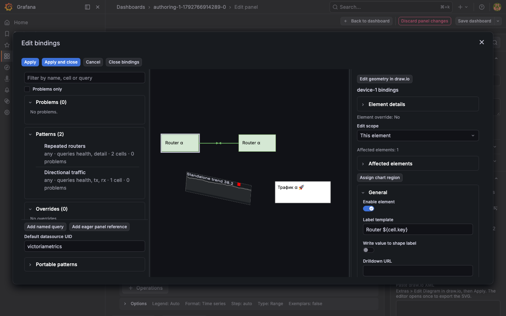
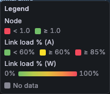
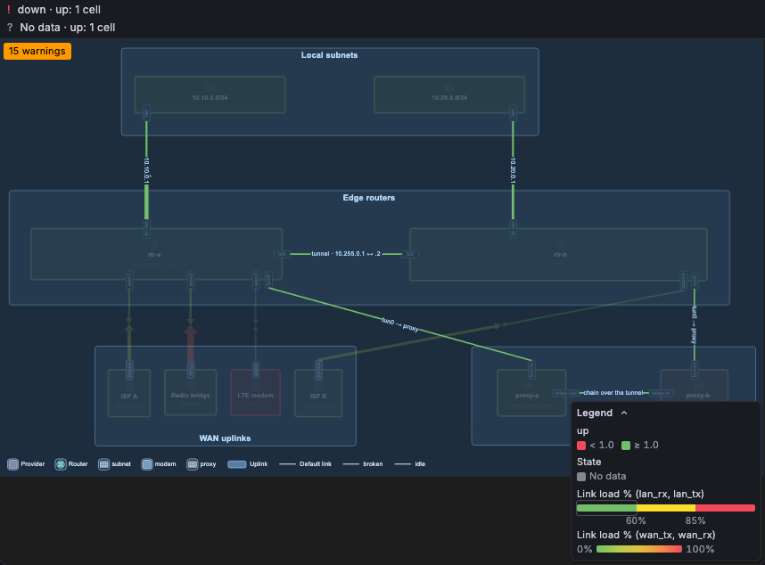
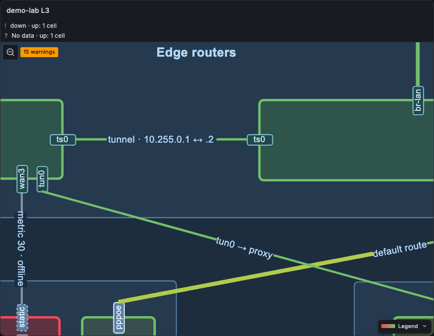
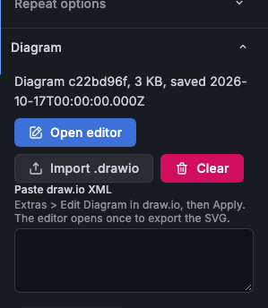

# draw.io map panel for Grafana

A Grafana panel plugin (`simnv-drawiomap-panel`). It shows a draw.io diagram as a network weathermap.

"draw.io" is a trademark of JGraph Ltd. This plugin is not affiliated with JGraph Ltd or with the draw.io project.

## What it does

- It colours each link by traffic, for each direction. Each half of the link has its colour and an arrow. The canvas shows no value labels.
- Explicit health rules mark abnormal devices with a state and a reason. Normal V2 devices keep their diagram colours. Legacy rules can colour icons, shapes or outlines.
- Configured hover values and histories load when the card opens. A click or tap pins the card. Explicit chart rectangles show selected trends or bounded bar gauges.
- The real draw.io editor opens in a modal.

View mode loads no draw.io code. The panel stores the diagram XML and the SVG that draw.io exported. The panel shows the SVG and writes colours into it.

## Requirements

- Grafana 12.4 or later (`>=12.4.0`). Exact tested releases, sandbox modes and the development build are in the [compatibility matrix](docs/research/authoring-compatibility.md).
- The plugin is not signed. Set `GF_PLUGINS_ALLOW_LOADING_UNSIGNED_PLUGINS=simnv-drawiomap-panel` (or `allow_loading_unsigned_plugins` in `grafana.ini`).
- A data source with time series. The demo uses VictoriaMetrics.

## Quick start

You need Node.js and Docker.

```bash
npm install
npm run build
npm run stack:up
npm run stack:smoke
```

The stack starts these services:

| Service         | URL                   |
| --------------- | --------------------- |
| Grafana 12.4.13 | http://localhost:3012 |
| Grafana 13.2.4  | http://localhost:3013 |
| VictoriaMetrics | http://localhost:8428 |

A generator pushes synthetic traffic series. Open the demo dashboard: http://localhost:3012/d/drawiomap-demo (or port 3013). Anonymous access is on, with the Admin role.

You see the demo-lab diagram. The links have colours from the synthetic traffic. The icon of the `lte` node is red because its `up` series is 0. Move the pointer on a link to see the traffic in each direction. Move it on `rtr-a` or `rtr-b` to see the CPU sparkline.

Stop the stack with `npm run stack:down`. This command also deletes the volumes.

## Diagram import

Open the panel editor and go to **Diagram**. There are three ways to add a diagram:

1. **Import .drawio.** Choose a `.drawio` file, for example a portograph export. The panel loads the file in the editor modal. The editor exports the SVG and the modal closes. The panel stores the XML and the SVG.
2. **Paste draw.io XML.** Paste the XML (from **Extras > Edit Diagram** in draw.io) and select **Apply pasted XML**. The panel accepts an `<mxfile>`, an `<mxGraphModel>`, or an SVG that has an embedded copy of the diagram.
3. **Open editor.** Draw or change the diagram in the real draw.io editor. **Save** and **Save & Exit** store the XML and the SVG.

The panel uses these cell attributes to find cells:

- Portograph diagrams use the `pg-*` attributes (`pg-id`, `pg-kind`, `pg-from`, `pg-to`). The contract is in `docs/research/portograph-contract.md`.
- For a hand-drawn diagram, a cell has its draw.io `id` and its label text. See `demo/rules-hand.yaml`.

Only page 1 of a multi-page diagram is shown. The panel shows a warning.

## Bindings, queries and chart regions

Bindings are edited in the **bindings popup**, a large dialog of the panel editor. The popup is available only while the panel editor is open. The dashboard view has no editor code: it never loads the popup.

Open it in one of three ways: the link button in the top-left corner of the panel (**Edit bindings**), the warning badge (it opens the first problem), or the **Edit bindings** button in the Diagram options. The popup has three panes. Drag the handles between them to resize; the sizes are kept for the next time.

- **List** (left): **Filter bindings** matches a name, a cell ID or label, or a query ID. **Problems only** hides the rows without a problem. The groups are Problems, Patterns, Overrides, Widgets and Queries, each with a count. A row shows its selector kind, the queries it uses, the number of matched cells and the number of problems. Use the arrow at the start of a row to read its problems. Override and widget rows have a delete button with a confirmation; the deletion goes into the draft. The footer holds **Add named query**, **Add eager panel reference**, **Default datasource UID** and the portable patterns.
- **Diagram** (centre): a live copy of the diagram with the draft bindings and the data of the panel. Pan and zoom as in the panel. Click an element to select it. **Shift**-click adds or removes elements, **Shift**-drag draws a selection box (see [Select several elements](#select-several-elements)). Pointing at a list row marks its cells.
- **Inspector** (right): the selected element, pattern, override, chart region or query. For an element it starts with a live **Hover card preview**: the card that the panel shows for the element, built from the draft and the panel data. It updates on each data refresh and on each edit. An element without hover rows shows "No card for this element".



Work in this order:

1. Select an element in the diagram, or a row in the list. The inspector focuses its heading and shows identity, matching patterns and element overrides.
2. Select **This element** or **All elements matching this pattern**. Use **Preview all pattern matches** to check every affected element and its shape, link, status, hover and chart bindings. Progress and per-match failures appear before Apply.
3. Select a query row to edit it. Native datasource editors retain native targets; **Preview query** checks an individual query for the selected element. Other native parameter values remain unvalidated until **Preview all pattern matches**.
4. Configure health, directional links and hover rows. Use explicit health mappings or opt-in thresholds. Zero traffic alone does not mean failure.
5. Select a rectangle and choose **Assign chart region**. Choose a trend or a bar gauge with meaningful minimum and maximum bounds.
6. Select **Apply** to keep the popup open, or **Apply and close**. Then save the Grafana dashboard. **Discard** restores the saved bindings and geometry in the open popup. **Cancel** closes the popup without an Apply. The buttons sit in the top row of the popup: **Undo** and **Redo** on the left; **Edit geometry in draw.io**, **Cancel**, **Discard**, **Apply** and **Apply and close** on the right. On a phone (a viewport narrower than 640 px or lower than 480 px) the popup is a full-screen sheet that respects the safe areas of the screen. The panes scroll inside the sheet and the buttons stay in view.

The popup edits a draft. The panel behind it keeps the saved bindings and shows the draft only after Apply or, with Apply while the popup is open, only after the popup closes (see [The panel while the popup is open](#the-panel-while-the-popup-is-open)). Close the popup with **Cancel**, the close button or **Esc**. When the draft has changes, the popup asks **Discard changes?** first; choose **Discard and close** to drop the draft or **Keep editing**. **Esc** closes only the innermost layer: an open menu, a datasource dialog, the draw.io editor or the question. If another editor saves the panel while the popup is open, a warning appears and Apply stops. Choose **Overwrite** to save your draft, or **Reload saved** to start again from the saved bindings. Leaving the panel editor closes the popup and drops its draft.

A warning icon marks a row with problems: an invalid config, an unknown query, an unresolved metadata template, no metric for a query, a pattern that matches no cell, and an override or chart whose cell no longer exists in the diagram. Each message shows the config path. A message for one cell is shown under the pattern or override whose value is the effective one after the merge. A problem of a named query is shown under every row that uses it. A problem with no owner row is shown in **General**; **Problems only** keeps it. A pattern ID that is used twice is flagged on every pattern with it. Select a row to open it. An override or widget selects its cell. A pattern selects its first matched cell with the scope **All elements matching this pattern**, so you can fix its selector. A row whose cell no longer exists only shows its problems; delete it or restore the cell. A panel that has only legacy rules shows a note that points to the Rules editor.

Draw.io owns geometry and stable cell IDs. The inspector owns queries, formatting, rules and chart behavior. **Edit geometry in draw.io** opens the editor on top of the popup; a save changes the diagram of the popup, and Apply commits it with the bindings. Deleted chart anchors remain diagnostic until repaired or explicitly removed. Duplicate physical IDs are rejected; copied semantic `pg-id` values must be repaired.

**Export patterns** copies a versioned document with referenced queries, charts and overrides. **Preview pattern import** reports conflicts, datasource context and anchor applicability. Choose Replace or New identity explicitly. Import stages a draft; Apply activates it. Native datasource UIDs stay explicit across panels.

The third demo panel, **Sanitized authoring topology**, has fictional repeated routers, a directional link and one standalone chart. Its Prometheus and TestData queries use synthetic data only.

### Undo and redo

The draft has a history. **Undo** and **Redo** in the toolbar, **Ctrl/Cmd+Z**, **Shift+Ctrl/Cmd+Z** and **Ctrl+Y** step through it. A step is one edit of the bindings, a query change, a deletion or a geometry save from draw.io. Typing in one field is one step; a pause of about one second, a selection of another element or an edit of another field starts a new step. In a text field, a text area and the datasource code editor, **Ctrl/Cmd+Z** keeps its normal meaning and undoes the typing there. With another dialog open (for example the Prometheus metrics explorer), the keys do nothing to the draft. **Apply** and **Discard** clear the history; the toolbar buttons and the keys then stop until the next edit. The history keeps the last 200 steps and the last 5 geometry saves.

### Field sources

Each field of the inspector shows where its effective value comes from (the controls of one metric binding, such as query, result field, reducer and matchers, share one chip on the metric section): **Pattern** and the pattern name, **Override** (the element override), or **Default** (nothing sets it). When the edited owner sets the value itself, a small button resets it: **Reset ... to pattern** for an element, **Reset ... to default** in the scope of a pattern. The reset removes the value from the override (or the pattern) so that the value of the pattern (or the default) applies again. An override that holds nothing any more is removed. Hover rows and the health rule are one unit each: a reset inside a hover row resets all **hover rows** at once, and a reset inside the health rule resets the whole **health rule**. The **Effective binding preview** shows the result.

### Narrow screens

Below 1000 px of popup width (a browser window narrower than about 1050 px) the three panes become the tabs **List**, **Diagram** and **Inspector**. One pane shows at a time. A click on an element in the diagram, or on a list row, opens the **Inspector** tab. The selection, the zoom of the diagram and the open editors stay when you change tabs.

### Select several elements

In the diagram, **Shift**-click an element to add it to the selection, or to remove it when it is selected. A click without **Shift** selects that element alone. The last element you pick is the primary one; it has a gap in its outline. With two or more elements selected, the inspector shows the heading "N elements" with the list of IDs, **Create pattern from selection** and **Bulk edit**. With one element left, it shows the sections of that element again.

**Shift**-drag on the diagram (mouse or pen) draws a selection box. The box adds every element that it touches to the selection. A node counts with its ports and icon, a link counts with its label; the canvas, layers, groups and the legend never join. You can release the pointer outside the diagram: the box is cut to the diagram. **Esc** during the drag cancels the box and selects nothing; the popup stays open. The click that ends a drag does not select anything. A plain drag still pans, a touch drag always pans, and a **Shift**-click without a drag still toggles.

### Create a pattern from a selection

With two or more elements selected, **Create pattern from selection** proposes a selector that matches them. It builds three kinds of proposal and shows the best one in editable fields: **Proposed kind**, **Proposed element IDs**, **Proposed attributes** (one `key=value` per line) and **Proposed label regex**.

- **Attributes**: the kind (when all elements share it) and the attributes that are equal in all selected elements. The identity attributes (`pg-id`, `id`, `label`, `pg-schema`) never count. The editor drops attributes one by one, the most common first, while the selector still matches no more extra elements.
- **Label**: the kind and a label regex that starts with the common label prefix, when the prefix has three characters or more.
- **Element IDs**: the selected IDs. It is the fallback and always comes last.

A proposal that misses a selected element is dropped. The attribute and label proposals rank together by their extra elements, fewest first; on a tie the attributes come first. The IDs always come last, even when they match fewer extra elements. Switch with the **Proposal** buttons. The line "matches N, extra M, missed K" counts what the shown selector matches. On the diagram, an element that the selector matches without being selected has a dashed warning outline (`extra`), and a selected element that it misses has a double error outline (`missed`). Both update with each edit of the fields. **Create pattern** adds one pattern with an empty display, opens it in the pattern scope, and is one step for **Undo**. Edit the pattern like any other.

### Bulk edit

With two or more elements selected, **Bulk edit** shows the fields of the display with the values that all selected elements share (the effective values after patterns and overrides). A field where the elements differ is empty and carries the chip **Mixed**. A change writes only that field, as a leaf, to the override of each selected element. Nothing else changes: the other fields of an override stay, the fields that an element inherits from a pattern stay inherited (an element without an override gets one that holds the new field alone), and the pattern is not touched. Clearing a field removes it from the overrides. It cannot hide a value that an element inherits from a pattern.

Hover rows, the health rule and each metric binding (query, result field, reducer and matchers) are one unit each. They are editable in bulk only when all selected elements have equal ones; then a change writes the whole unit to each override. When they differ, even in one matcher, the section shows **Mixed, edit per element** and no fields. A mixed field has a **Clear** button that removes the field from the override of every selected element; a mixed value that you leave alone is never written. **Remove overrides of the selection** removes the overrides of all selected elements. A bulk change, and the removal, are one step for **Undo**; typing into one field joins one step.

### The panel while the popup is open

While the popup is open, the panel behind it does no work for dashboard refreshes: it keeps its last picture, and it does not run its bindings again, draw its overlay again or read new data. The dashboard keeps running its own queries. **Apply** writes the options at once, but the panel shows them only when the popup closes. When the popup closes, the panel renders once with the latest data and options. A result that arrived for the panel's queries in the meantime shows then. A result of a query that you changed is dropped. The clock keeps running: when a sample passes its freshness limit while the popup is open, the status of the panel behind turns stale, because stale data must never look fresh. Opening the popup closes the pinned card and the legend highlight of the panel.

### Delete a query

Select a query row, then **Delete query**. The query pane also shows a table with the first 20 rows of the first frame of **Preview query**, and a **Used by** list of the patterns, overrides and charts that use the query; select an entry to open it. A query that is used asks **Delete query?** first. The bindings that use it stay and report an unknown query until you pick another. **Undo** brings the query back.

### Demand, cache and sample freshness

Saved visible bindings and displayed chart regions execute while the panel editor is open. The popup also runs its draft bindings for its own diagram; it shares equal requests with the panel through the panel cache. Edited native queries run for the popup stage only, never for the panel behind it. Full pattern and individual query previews reuse compatible results from saved visible charts, including charts loaded at a different pixel resolution. Full pattern preview also reuses eager and other compatible prepared results, shares equal requests through the panel controller, and releases completed subscriptions. Its prepared results use the existing entry, sample and byte limits; exhausted limits appear as failures. Edits, selection, import, Discard, Apply and dashboard context changes discard obsolete preview results. Full pattern preview never starts background refresh. Hover-only scalar values and histories request nothing before display. Identical demands share a request; a reopening reuses the panel cache. A named eager panel reference still runs through Grafana's Queries tab. Convert it to a native definition and manually remove its eager copy there; keep the warning until removal is verified.

Configured hover values and histories also reuse ready or empty saved chart results for the same query, element parameters and dashboard context. Opening the card adds no request when that data is available. Saved updates reach the open card. If the chart disappears, the open card starts ordinary demand; closing the card releases it. Pending or failed chart requests do not prevent necessary hover fetching.

Both preview actions and scalar/history hover prefer ready data when compatible saved requests have mixed results. Empty results satisfy reuse only when no compatible ready result exists. Failed, unsupported or pending requests still require ordinary demand when no successful compatible result is available. Completed previews retain their one-shot report; saved charts still display later monitoring failures.

The cache is panel-local. Its key includes datasource, native target, element parameters, dashboard variables/range, generation and pixel resolution. A result is reused at any age while its generation is current: the key holds the frozen absolute range, so the same query would return the same data. A dashboard refresh, a time range change or a variable change starts a new generation and runs the active demand again. A generation is never reused: a return to an earlier variable value or range fetches again. The cache and the generation belong to the panel on its dashboard, not to one mount of the panel: when Grafana mounts the panel again (the panel editor, a lazy panel that scrolls back into view), the diagram queries do not run again. An unmounted panel keeps them for one minute. It retains at most 64 entries, 100,000 values and 8 MiB, evicting inactive least-recently-used entries. Execution admits four concurrent requests and 64 queued requests. One result is limited to 100,000 values and 8 MiB. Errors are not cached. Closing, switching or unmounting releases demand; obsolete results cannot replace the current card. Datasource cancellation does not guarantee cancellation of server work.

Sample freshness is independent of cache age. Enable it with an expected cadence and a stale-after interval. Health, scalar hover rows and charts transition when sample age crosses that interval, even without another response. Missing, zero, down, stale and incomplete coverage have distinct explanations. No cadence is inferred from the chart step. Dashboard refresh/context changes refresh active demand; inactive cards do not refresh.

### Sparkline Y range

All sparklines use the same Y range: card rows, link halves (legacy rules too) and chart regions. A series without negative values starts at 0, so a small change on a flat series (for example PoE power) does not look like a big climb. The top is the largest value, the capacity, or 100 for the `percent` unit (1 for `percentunit`), whichever is largest. A series with negative values uses its own min and max. A combined up/down row has its own range rule, see [Combined up/down row](#combined-updown-row).

Each bound uses the first source that has a value:

1. `min` and `max` of the hover row or the chart region (numbers).
2. **Min** and **Max** of the Grafana field config.
3. The default above.

The bounds are soft: the range always holds all values. To use the data range instead of the zero baseline, set `"min": "auto"`. The span is then at least 10% of the largest value, centred on the data:

```json
{
  "kind": "history",
  "label": "PoE power",
  "binding": { "queryId": "poe", "match": { "port": "${cell.key}" }, "reducer": "last" },
  "min": "auto"
}
```

A chart region takes the same keys:

```json
{
  "id": "poe-chart",
  "anchorCellId": "chart-1",
  "kind": "sparkline",
  "label": "PoE power",
  "binding": { "queryId": "poe", "match": {}, "reducer": "last" },
  "min": "auto",
  "max": 30
}
```

The inspector has the fields **Hover row N minimum**, **Hover row N maximum** and **Chart minimum**. Type a number or `auto`.

### Combined up/down row

A history row can show the two directions of one subject (a port, a link) in one chart. Give it `series` instead of `binding`:

```json
{
  "kind": "history",
  "label": "Traffic",
  "unit": "bps",
  "capacity": 100000000,
  "url": "/d/iface?var-device=${cell.key}",
  "series": [
    {
      "binding": { "queryId": "tx", "match": { "device": "${cell.key}" }, "reducer": "last" },
      "direction": "up",
      "label": "↑"
    },
    {
      "binding": { "queryId": "rx", "match": { "device": "${cell.key}" }, "reducer": "last" },
      "direction": "down",
      "label": "↓"
    }
  ]
}
```

| Key                  | Meaning                                                                                                                                                        |
| -------------------- | -------------------------------------------------------------------------------------------------------------------------------------------------------------- |
| `series`             | One or two entries. Each direction (`up`, `down`) can occur once. A row has `binding` or `series`, not both.                                                   |
| `series[].direction` | `up`: the traffic that leaves the subject (transmit, tx). `down`: the traffic that enters it (receive, rx).                                                    |
| `series[].label`     | The text before the value. The default is `↑` or `↓`.                                                                                                          |
| `series[].capacity`  | Optional. The capacity of this direction: a number in the unit of the values, or a template in bit/s. It replaces the row `capacity` for this direction.       |
| `capacity`           | Optional. A number in the unit of the values, or a template in bit/s (see below). For both directions. The default is the field config **Max** of each series. |
| `max`                | The half range M (see below): `"auto"` (the default), `"capacity"` or a number in the unit of the values.                                                      |
| `height`             | Optional. The height of the chart in px, from 16 to 400. See [Chart height](#chart-height).                                                                    |
| `unit`, `url`        | As for other rows. `min` applies only to a row with one direction.                                                                                             |

With both directions, up is above a thin zero line and down is mirrored below it (drawn as negative values). The range is symmetric, from -M to M, so the zero line is in the middle. The two directions share one scale. A row with one direction stays positive and goes from 0 (or its `min`) to M.

| `max`               | M                                                                                                                  |
| ------------------- | ------------------------------------------------------------------------------------------------------------------ |
| `"auto"` or not set | The largest absolute value of the two directions over the time range × 1.1. The data fills about 90% of each half. |
| `"capacity"`        | The capacity, or the largest absolute value when it is larger. Without a capacity, as `"auto"`.                    |
| a number            | That number. A larger value still fits: M is then the largest absolute value.                                      |

The capacity gives only the percent text and the colours; it does not change the range, unless `max` is `"capacity"`. Thus 12 Mb/s on a 1 Gb/s link fills the chart. When all values are 0, M is 1% of the capacity, or 1 when the capacity is not known.

```json
{ "kind": "history", "label": "Traffic", "capacity": 1000000000, "max": "auto", "series": [] }
{ "kind": "history", "label": "Traffic", "capacity": 1000000000, "max": "capacity", "series": [] }
{ "kind": "history", "label": "Traffic", "max": 50000000, "series": [] }
```

In these examples, `series` is shortened; use the two entries of the example above.

The value text shows both current values, formatted with the field display processor, for example `↑ 10 Mb/s · 10%  ↓ 41 Mb/s · 41%`. The percent of the capacity shows only when the capacity is known. Each direction has its own colour, from the field config and thresholds of its own value, as a link half. With a capacity, the threshold steps are percent. The arrows in the value text have the colour of their line. A direction without data shows `No data` and no line; the other direction stays. A click on the row opens its `url`.

#### Template capacity

The row `capacity` can be a template. It resolves against the cell scope when the card opens, so one pattern fits many links. The value is in bit/s and must resolve to a finite number above 0.

```json
{ "kind": "history", "label": "Traffic", "capacity": "${cell.capacity_a2b_bps}", "max": "capacity", "series": [] }
```

On a port, use for example `"${cell.capacity_bps}"`. The panel converts the bit/s to the unit of the values (for example `Bps`), so the percent is correct. A number stays in the unit of the values.

The order is: row `capacity` (a number, or a resolved template), then the largest field config **Max** of the series, then no percent. If the template does not resolve, or does not give a positive number, the row shows no percent (the field **Max** does not take its place) and the card adds the diagnostic `unresolved-metadata` at `cells.<id>.hover.rows[<i>].capacity`. With `"max": "capacity"`, the range uses the resolved capacity. When it is not known, the range is as `"auto"`.

#### Capacity of each direction

An asymmetric link has one capacity for each direction. Set `capacity` on a `series` entry (a number, or a template in bit/s). The percent and the colour of each direction use its own capacity.

```json
{
  "kind": "history",
  "label": "Traffic",
  "unit": "bps",
  "max": "capacity",
  "series": [
    {
      "binding": { "queryId": "tx", "match": { "device": "${cell.key}" }, "reducer": "last" },
      "direction": "up",
      "capacity": "${cell.capacity_a2b_bps}"
    },
    {
      "binding": { "queryId": "rx", "match": { "device": "${cell.key}" }, "reducer": "last" },
      "direction": "down",
      "capacity": "${cell.capacity_b2a_bps}"
    }
  ]
}
```

For one direction, the order is: the `capacity` of the `series` entry, the row `capacity`, the **Max** of its field config, no percent. A `series` capacity or a row capacity that does not resolve gives no percent for the direction (see above). With `"max": "capacity"`, the half range is the larger of the two capacities. The legend title stays **Link load %**. The demo panel 3 has a link with the attributes `capacity_a2b_bps` (100 Mb/s) and `capacity_b2a_bps` (50 Mb/s), and its combined row uses them.

#### Chart height

A chart with both directions is 80 px tall by default. Each half is 40 px tall, the same height as a single sparkline. A row with one direction is 40 px tall. With both directions, the zero line stays in the middle of the chart.

Set `height` on a V2 `display.hover.rows` history row to change the chart height. Use a number from 16 to 400, in pixels. This option applies to single and combined history rows. Legacy `shape.card` rows do not accept this option.

Click or tap to pin the card before you scroll. The desktop card scrolls when its content exceeds the available panel height. In panels narrower than 480 px, the card becomes a bottom sheet. The sheet scrolls when its content exceeds 60% of the viewport height.

```json
{ "kind": "history", "label": "Traffic", "capacity": 100000000, "height": 120, "series": [] }
{ "kind": "history", "label": "CPU", "height": 64, "binding": { "queryId": "cpu", "match": {}, "reducer": "last" } }
```

In the first example, replace the empty `series` with the two entries from the combined row example above. In the inspector, use **Hover row N height**. Clear the field to restore the default height.

The third demo panel shows a combined row on its link (synthetic transmit and receive rate of `rtr-a:wan1`). The link has two capacities, 100 Mb/s up and 50 Mb/s down.

### Status summary

A band above the diagram has one row for each status cause: the state, the reason and the number of elements, for example `? missing   No data   26 elements`. Elements with the same state and reason share one row, also when each element has its own query. The most severe cause is first (down, critical, warning, stale, missing), then the cause with the most elements. Normal elements do not show in the band.

The band has at most **Status summary rows** rows (default 3), and at most half of the panel height. When there are more causes, the last row is `+N more (M elements)` (with one row: `N causes (M elements)`). Click it to show all causes; **Show less** collapses the band again. The band takes its own height above the diagram, so it never covers the diagram. The diagram fits into the remaining height. Set **Status summary rows** to 0 to hide the band. The markers on the elements stay.

### Supported query results and migration

Finite Grafana data frames with one selected numeric series and one time field support histories. Null gaps retain their meaning. Empty, single-sample, failed and stale histories show text. Logs, traces, legacy datapoint objects, streaming/partial frames, ambiguous numeric fields and invalid timestamps receive validation messages. Direct queries do not automatically inherit Grafana panel transformations or field overrides; use returned field configuration or explicit inspector units.

Only the installed Prometheus and TestData plugins in the [tested matrix](docs/research/authoring-compatibility.md) have browser evidence. Other datasource editors can require capabilities this panel does not supply. Without a supported editor, use validated native-target JSON import. This is not universal datasource compatibility.

The plugin is unshipped. Recreate authoring configuration if a saved format cannot be migrated. Existing V1 rules remain available until a V2 config is applied; a V2 config takes precedence without deleting the saved legacy options or dashboard. Back up dashboard JSON before conversion. Revert the implementation commits and restore that JSON for rollback; draw.io XML/SVG alone does not contain plugin behavior.

## Legacy rules

Existing V1 panels use the **Legacy rules** option. Use the form or the YAML tab. Copy `demo/rules.yaml` as a start:

```yaml
- name: links
  select: { kind: link }
  link:
    a2b: { refId: A, match: { job: 'node-${from.node}', device: '${from.port}' } }
    b2a: { refId: A, match: { job: 'node-${to.node}', device: '${to.port}' } }
    card: { title: '${from.node} ↔ ${to.node}' }
  reducer: last
  url: '/d/drawiomap-demo?var-job=node-${from.node}&var-device=${from.port}'
  urlTitle: 'Traffic of ${from.node}:${from.port}'
- name: lan by port speed
  select: { kind: link, attrs: { pg-to: '/:br-lan$/' } }
  link:
    capacity: { refId: S, match: { job: 'node-${to.node}', device: '${to.port}' } }
- name: wan uplinks
  select: { kind: link, attrs: { pg-to: '/^rtr-(a|b):(wan1|wan2|wan3|pppoe)$/' } }
  link:
    a2b: { refId: W, match: { job: 'node-${from.node}', device: '${from.port}' } }
    b2a: { refId: W, match: { job: 'node-${to.node}', device: '${to.port}' } }
- name: tunnels 100M
  select: { kind: link, attrs: { pg-to: '/:(ts0|tun-in|relay-in)$/' } }
  link: { capacity: 100000000 }
- name: node up
  select: { kind: node }
  shape:
    series: { refId: C, match: { job: 'node-${cell.pg-id}' } }
    target: icon
    card:
      - { title: state, refId: C, match: { job: 'node-${cell.pg-id}' } }
      - { title: load 1m, refId: D, match: { job: 'node-${cell.pg-id}' } }
  url: '/d/drawiomap-demo?var-job=node-${cell.pg-id}'
  urlTitle: 'Host ${cell.pg-id}'
- name: router cpu
  select: { ids: [rtr-a, rtr-b] }
  shape:
    card:
      - title: CPU
        refId: E
        match: { job: 'node-${cell.pg-id}' }
        unit: percent
        decimals: 0
        url: '/d/drawiomap-demo?var-job=node-${cell.pg-id}&var-metric=cpu'
      - { title: state, refId: C, match: { job: 'node-${cell.pg-id}' } }
```

Rules are an ordered list. A later rule overrides an earlier rule for the same property of the same cell. In the example, the `lan by port speed` rule adds a capacity to the LAN links. The `wan uplinks` rule changes the series of the WAN links to query `W`. The last rule replaces the card rows of the two routers. The `series` and the `target` of the `node up` rule stay.

The rules do not set colours. The colours come from the field config of the panel. See [How colours and thresholds work](#how-colours-and-thresholds-work).

### Rule fields

| Field        | Meaning                                                                                                                                             |
| ------------ | --------------------------------------------------------------------------------------------------------------------------------------------------- |
| `name`       | Name of the rule. The rule editor and the warnings show it.                                                                                         |
| `select`     | Which cells the rule applies to. See below.                                                                                                         |
| `link`       | For links. `a2b` and `b2a` select one series for each direction. `capacity` is in bit/s (see [Capacity](#capacity)). `card` sets the card of links. |
| `shape`      | For shapes. See below.                                                                                                                              |
| `reducer`    | `last` (default), `mean`, `max` or `min`. Reduces the series to one value. The card rows use it too.                                                |
| `label`      | Template of the text that `shape.text` writes into the node label. The default is `${value}`. Links ignore it (the panel shows a warning).          |
| `thresholds` | Removed. A rule with it still loads, but the panel ignores it and shows a warning. Set **Thresholds** in the field config.                          |
| `url`        | Link in the card footer, and the click target of card rows without their own URL. It can use templates and dashboard variables.                     |
| `urlTitle`   | Title of the `url` link in the card footer (a template). The default is `Open dashboard` for a `/d/<uid>` URL, else `Open <card title>`.            |

A series selector has `refId` (the query), `name` and `match` (a map of label name to matcher).

#### `shape`

| Field    | Meaning                                                                                                                                                                         |
| -------- | ------------------------------------------------------------------------------------------------------------------------------------------------------------------------------- |
| `series` | The series that sets the state colour.                                                                                                                                          |
| `target` | What the colour changes: `icon` (default), `shape` (the fill of the whole shape) or `stroke` (the outline). Without an icon, or with a bitmap icon, `icon` colours the outline. |
| `text`   | `true` writes the value into the node label (see `label`).                                                                                                                      |
| `card`   | A list of card rows. Without it, the card has one row for `series`.                                                                                                             |

The icon of a node is the cell with `pg-kind="node-icon"` and `pg-of="<node pg-id>"`. Older portograph exports have no such tag. Then the panel uses the cell `pg-icon~<pg-id>`. Some icons are a white glyph on a tile (`pg-iconTile~<pg-id>`). Then the tile takes the colour. A hover or a click on the icon or on the node description opens the card of the node. A hover on a link label (`pg-kind="link-label"` with `pg-of`, or `pg-linkLabel~<link pg-id>`) opens the card of the link. Each other cell with `pg-of` belongs to the node or link with that `pg-id`. Such sub-cells never open a card of their own.

The old keys `fill: true` and `stroke: true` still work: they are the same as `target: shape` and `target: stroke`. The panel ignores the removed key `shape.sparkline` and shows a warning.

#### Card rows (`shape.card`)

Each row is a series selector with these extra fields:

| Field      | Meaning                                                                                                                    |
| ---------- | -------------------------------------------------------------------------------------------------------------------------- |
| `title`    | Row title (a template). The default is the series name.                                                                    |
| `unit`     | A Grafana unit id, for example `percent`. The default is the unit of the field config.                                     |
| `decimals` | Number of decimals. The default comes from the field config.                                                               |
| `url`      | Click target of the row (a template). `${labels.<name>}` uses the labels of the row series. The default is the rule `url`. |

#### Link card (`link.card`)

| Field   | Meaning                                                                               |
| ------- | ------------------------------------------------------------------------------------- |
| `title` | Card title (a template). The default is the label text of the link, else its `pg-id`. |
| `url`   | Click target of the `a2b` and `b2a` rows (a template). The default is the rule `url`. |

The card of a link always has one row for each bound direction: the current value, the percent of capacity and a sparkline.

### Cell selectors (`select`)

| Key       | Meaning                                                                        |
| --------- | ------------------------------------------------------------------------------ |
| `kind`    | `node`, `port`, `link`, `link-label`, `other` or `any`.                        |
| `ids`     | A list of cell ids or `pg-id` values.                                          |
| `attrs`   | A map of attribute name to matcher (the `data-meta-*` attributes of the cell). |
| `label`   | A matcher for the label text.                                                  |
| `between` | `[a, b]`. A link between two nodes, in any direction.                          |

A matcher is an exact string, or a regular expression between slashes: `/^rtr-a:(wan1|wan3)$/`.

### Templates

| Template                       | Value                                                                         |
| ------------------------------ | ----------------------------------------------------------------------------- |
| `${cell.<attr>}`               | Any attribute of the cell, for example `${cell.pg-id}` or `${cell.capacity}`. |
| `${from.node}`, `${from.port}` | The first end of a link (from `pg-from`).                                     |
| `${to.node}`, `${to.port}`     | The second end of a link (from `pg-to`).                                      |
| `${labels.<name>}`             | A label of the matched series. Use it in `url`.                               |
| `${value}`                     | The value, formatted with the unit and decimals of the field config.          |
| `${percent}`                   | The value as a percent of the capacity.                                       |

`${value}` and `${percent}` are for `label`. Grafana dashboard variables also resolve in all URLs. If a template in a series selector does not resolve, the cell is "unbound". It is grey and the panel shows a warning.

A missing series gives a grey "no data" state. It is never green.

Unit, decimals, value mappings and data links come from the Grafana field config.

## How colours and thresholds work

The panel has no colour settings of its own. It uses the standard field config of Grafana, as all Grafana panels do:

- **Standard options → Color scheme**: for example **From thresholds**, **Single color**, **Classic palette** or a continuous scheme such as **Green-Yellow-Red (by value)**.
- **Thresholds**: the steps and their colours.
- **Standard options → Max**: a capacity for links (see [Capacity](#capacity)).
- **Overrides**: each of these settings for one query (**Fields returned by query**), one series name, or a regex. Use overrides to give each kind of link its own scale, for example a continuous scheme for the WAN query and thresholds for the LAN query.

For each link half and each shape, the panel finds the matched series. Then it uses the field config of that series, with the overrides applied:

```text
matched series ─▶ field config (defaults + overrides)
                        │
        link half with a capacity?
          │ yes                                   │ no (and all shapes)
          ▼                                       ▼
  percent = value in bit/s / capacity × 100       the display colour of the raw value:
          │                                       value mappings, then thresholds
          ├─ From thresholds: the steps are       and Color scheme (like a Stat panel)
          │  percent (in Absolute and in
          │  Percentage mode)
          ├─ continuous scheme: percent / 100
          │  is the position on the scale (0..1)
          └─ other schemes: the colour of the scheme
```

- A link half with a capacity: the colour input is the utilisation, 0 to 100 %. A step at 85 means 85 % of the capacity. Values above 100 % get the end colour of a continuous scheme. The line width also follows the percent (option **Link width**).
- A link half without a capacity, and every shape: the colour is the normal display colour of the raw value, as in any Grafana panel. For example, an `up` query with the thresholds base red and 1 green colours a node green when it is up.
- No data: always grey, never green.

The overlay attribute `data-dmap-step` is the index of the active threshold step.

### Colour legend

A small legend in a corner of the panel shows each colour that the bound cells can show now, with its threshold or its text. The panel makes it from the colour settings above. You do not configure the scales.



- One block for each colour scale, with the unit or the kind as the title: **Link load %** for links with a capacity, else the query name (or **Link** or **Node**) and the unit symbol, for example `PoE W`. The **Display name** of the field replaces this title. Two different scales with the same title get their queries in brackets, for example `Link load % (A)` and `Link load % (W)`.
- **From thresholds**: one swatch for each step, from low to high: `< 60%`, `≥ 60%`, `≥ 85%`. Links with a capacity show percent. Other values show the field unit.
- A continuous scheme: a gradient bar from `0%` to `100%` for links with a capacity, else from the field **Min** to **Max**.
- **Single color** and **Shades**: one swatch, `All values`.
- Value mappings with a colour: one swatch with the mapping text, before the threshold swatches. A link with a capacity takes its colour from the percent, so its mappings do not show.
- **Classic palette** (a colour for each series): no block, because the colour does not tell a value.
- **Status**: the colours of the status markers: `Down, critical`, `Warning, stale` and `Missing`. Normal elements have no marker.
- **No data**: the grey of links and shapes without data.
- Identical scales merge into one block, also when they come from different queries. An override that changes the thresholds or the scheme of one query gives that query its own block.

Move the pointer on a swatch or a gradient bar, or focus it with Tab: the elements in that band stay visible and the other elements of the legend dim. Move the pointer away, or move the focus, to show all elements again. On a phone, which has no hover, tap an entry to show its elements. Tap the same entry again, or tap anywhere else, to show all elements again. The dim uses one CSS class on the diagram, so it is cheap on a large diagram. It does not change a pinned card or the link colour overlays.

**Legend rows inside the diagram.** A portograph diagram draws its own legend with one row for each node symbol (for example `router`). The panel links such a row to its nodes when the node cells carry the attribute `data-meta-pg-symbol` with the same symbol name as the row (`pg-legendRow~symbol:router` matches `data-meta-pg-symbol="router"`). Then the pointer, the keyboard focus (Tab) or a tap on the row, its swatch or its tile shows the nodes of that symbol, with their icons and descriptions, and dims the other nodes that have a symbol. A diagram without the attribute does not change: its rows do nothing. In the demo network, the provider and proxy nodes of the L3 diagram carry it.



The legend starts as a small chip with a colour swatch and the word **Legend**. Click or tap the chip, or focus it and press Enter or Space, to open the full legend. Click the **Legend** header again to close it. The pictures above show the open legend.

You can move the legend, closed or open, to any place in the panel:

- Drag the header with the mouse or a finger. A move of less than 4 px is a click. A drag does not open or close the legend, does not pan or zoom the diagram and does not open a card.
- With the focus on the legend, the arrow keys move it by 10 px. Shift with an arrow key moves it by 50 px.
- Double-click the header, or press Home, to put it back in its corner.

The legend never leaves the panel, also when you make the panel smaller. The **Corner** option sets the place where it starts. The place and the open or closed state are not saved: a reload shows the legend again as the options say.

The legend stays in its place when you zoom, pan or scroll the diagram. In the top-left corner, it starts below the **Reset zoom** button and the warning badge, and below the status band. In the top-right corner, it starts below the area of the Grafana panel menu button. It catches the pointer only inside its own box. It is above the diagram and below the hover cards.

The options are in the **Legend** group:

| Option          | Path               | Meaning                                                                    |
| --------------- | ------------------ | -------------------------------------------------------------------------- |
| Show legend     | `legend.show`      | Default on.                                                                |
| Corner          | `legend.corner`    | `bottom-right` (default), `bottom-left`, `top-left` or `top-right`.        |
| Maximum scales  | `legend.maxBlocks` | The legend shows at most this number of blocks, then `+N more`. Default 4. |
| Start collapsed | `legend.collapsed` | Default on: the legend starts as a chip. Off: it starts open.              |

A saved panel without `legend.collapsed` starts collapsed.

In the panel JSON:

```json
{ "legend": { "show": true, "corner": "bottom-right", "maxBlocks": 4, "collapsed": true } }
```

### Capacity

The panel gives each link half a capacity in bit/s. It uses the first source that gives a value:

| Order | Source            | Example                                                                                         | Notes                                                                                                                              |
| ----- | ----------------- | ----------------------------------------------------------------------------------------------- | ---------------------------------------------------------------------------------------------------------------------------------- |
| 1     | A series          | `capacity: { refId: S, match: { job: 'node-${to.node}', device: '${to.port}' }, reducer: max }` | For example `node_network_speed_bytes`. The unit of the field converts the value to bit/s (`Bps` multiplies by 8). Templates work. |
| 2     | A cell attribute  | `capacity: '${cell.capacity}'`                                                                  | The `capacity` attribute of the cell, for example `meta: { capacity: 1e9 }` in a portograph YAML file.                             |
| 3     | A number          | `capacity: 1000000000`                                                                          | bit/s.                                                                                                                             |
| 4     | The field **Max** | **Standard options → Max** of the traffic series, or an override for one query                  | In the unit of the field, for example Max `100000000` with the unit `bits/sec(SI)`.                                                |

The series source uses the rule `reducer` when the selector has no `reducer`. If the capacity series is missing, the field **Max** applies and the panel shows a warning in edit mode. A template that does not resolve makes the link unbound (grey, with a warning).

The hover card shows the capacity of each half, for example `41 Mb/s · 41% of 100 Mb/s`. Without a capacity, it shows only the value.

The units are the data-rate units of Grafana: `bps`, `Kbits` … `Pbits`, `Bps`, `KBs` … `PBs`, and the binary (IEC) forms. A field without a unit is in bit/s. A unit that is not a data rate gives a warning, and the panel uses the raw value as bit/s.

#### Capacity of each link direction (V2 configuration)

In `display.link` of a V2 pattern, each half can have its own capacity. All values are in bit/s.

```json
{
  "link": {
    "a2bBinding": { "queryId": "tx", "match": { "device": "${cell.key}" }, "reducer": "last" },
    "b2aBinding": { "queryId": "rx", "match": { "device": "${cell.key}" }, "reducer": "last" },
    "capacityA2b": "${cell.capacity_a2b_bps}",
    "capacityB2a": "${cell.capacity_b2a_bps}",
    "capacity": 100000000
  }
}
```

| Key                                        | Meaning                                                                                                      |
| ------------------------------------------ | ------------------------------------------------------------------------------------------------------------ |
| `capacityA2b`, `capacityB2a`               | A number or a template, for one half.                                                                        |
| `capacityA2bBinding`, `capacityB2aBinding` | A query binding for one half. It is read like `capacityBinding`: the field unit converts the value to bit/s. |
| `capacityBinding`, `capacity`              | As before: shared by both halves.                                                                            |

The order for each half is: its binding, its number or template, `capacityBinding`, `capacity`, the field **Max**, no percent. A value that is missing, not positive or not a number falls to the next source. A directional template that does not resolve also adds the diagnostic `unresolved-metadata` at `cells.<id>.link.capacityA2b` (or `capacityB2a`). The legend title stays **Link load %**.

The demo dashboard uses all four sources: LAN links get the port speed series `S`, WAN links the **Max** of an override of query `W`, tunnels a number, and the hand-drawn panel the `capacity` attribute of its cells.

## Hover card

The canvas shows only colours. The values show in a card:

| Action                             | Result                                                                                               |
| ---------------------------------- | ---------------------------------------------------------------------------------------------------- |
| Move the mouse on a link or a node | The card shows near the pointer. It goes away when the pointer leaves the cell.                      |
| Click a cell                       | The card stays (it is pinned). It has a close button (✕), clickable rows and the footer links.       |
| Click another cell                 | The pinned card moves to that cell.                                                                  |
| Esc, ✕, or a click outside         | The pinned card closes.                                                                              |
| Tap a cell (phone, tablet)         | The card opens pinned. Devices without hover (`(hover: none)`) do not open a card on a pointer move. |
| Click or tap a row or a sparkline  | Opens the URL of the row in a new tab (see `shape.card[].url` and `link.card.url`).                  |
| Tab to a cell, then Enter or Space | The card opens pinned. Esc closes it and the focus goes back to the cell.                            |
| Move over a chart in a pinned card | A crosshair and the Grafana tooltip show the time and the value of each series (see below).          |

**Chart tooltip.** In a pinned card, move the pointer over a chart: a crosshair follows the pointer and the standard Grafana tooltip shows the time of the nearest sample, and the colour, name and value of each series. The values use the unit and decimals of the field. A gap shows "–". A combined up/down row shows both directions in one tooltip. On a phone, tap or drag on a chart in the sheet; the tooltip stays until you tap outside the chart. With the keyboard, Tab to the chart in a pinned card, then use the left and right arrow keys to move the sample; Esc hides the tooltip (a second Esc closes the card) and Enter follows the row link. The tooltip does not change the Y range, and a click on the chart still opens the row link. The hover card that is not pinned shows no tooltip.

The card stays inside the panel. It scrolls when it is too long. In a panel narrower than 480 px (a phone), the card is a sheet at the bottom of the screen, with the width of the panel. The sheet stays visible also in a panel that is taller than the screen. It is at most 60% of the screen height, scrolls when it is too long, and keeps clear of the home indicator (the safe-area inset). The sheet is above the Grafana menus. ✕, Esc or a tap outside the panel and the sheet closes it. The page does not move when the sheet opens.

### Which cells open a card

A cell opens a card only when both conditions are true:

- The kind of the cell is in the **Hover kinds** panel option (group **View**, option path `hover.kinds`). The default is `node`, `link`, `port` and `other`.
- The card has content: at least one row (a status, a value, a history or a metadata row) or one footer link.

Thus by default the empty background (`pg-canvas`), the layers, groups (`pg-group~…`, `pg-groupTitle~…`), the legend (`pg-legend…`) and cells without bound rows or links open nothing.

Only the cells that open a card show the hand cursor and are in the Tab order. Their parts (the icon, the description and the link label) also show the hand cursor, because they open the card of their node or link. All other cells show the default cursor.

| Kind         | Cells                                                                                                  |
| ------------ | ------------------------------------------------------------------------------------------------------ |
| `node`       | `pg-kind="node"`. In a plain draw.io diagram (no `pg-schema`): each vertex.                            |
| `link`       | `pg-kind="link"`. In a plain draw.io diagram: each edge.                                               |
| `port`       | `pg-kind="port"`.                                                                                      |
| `link-label` | `pg-kind="link-label"`.                                                                                |
| `group`      | `pg-group~…` and `pg-groupTitle~…`.                                                                    |
| `canvas`     | `pg-canvas`, `pg-layer~…`, and the draw.io root and layers (cells that draw nothing of their own).     |
| `legend`     | `pg-legend…`.                                                                                          |
| `other`      | Other `pg-` cells and cells with another `pg-kind`, for example a chart anchor with `pg-kind="other"`. |

In the panel JSON, the option is:

```json
"options": { "hover": { "kinds": ["node", "link", "port", "other"] } }
```

To remove the card of one element, add an element override with `"hover": { "enabled": false, "rows": [] }` in its display.

A card row has a head line and a sparkline below it. The head line has a colour dot, the title and the current value with its unit (for example `isp-a → rtr-a   41 Mb/s · 41%`). The sparkline has the full width of the card. Its Y range starts at 0 for a series without negative values and reaches up to the capacity (see [Sparkline Y range](#sparkline-y-range)). Its time axis is the part of the dashboard time range that has data, so the line goes from edge to edge also when the series starts late. Below the sparkline, muted text shows the min and the max of the series.

The footer has the rule URL (title: `urlTitle`) and the data links of the field config (title: the data link title). A link that opens in a new tab has an external-link icon.

The pinned card is a dialog (`role="dialog"`) and gets the focus. The ✕ button is a normal button. Each bound cell is a button for the keyboard (`tabindex="0"`). The panel builds the card only when it opens, and only for one cell.

## Zoom options

In the **View** group of the panel options:

| Option               | Meaning                                                                                                                                                                         |
| -------------------- | ------------------------------------------------------------------------------------------------------------------------------------------------------------------------------- |
| Zoom: Fit            | The whole diagram fits in the panel. This is the default.                                                                                                                       |
| Zoom: Fit width      | The diagram has the panel width. The panel scrolls vertically.                                                                                                                  |
| Zoom: Original       | The diagram has its original size.                                                                                                                                              |
| Zoom: Custom, Zoom % | The diagram has the size that you set in percent.                                                                                                                               |
| Minimum scale        | Fit and Fit width only. Do not shrink below this scale in Fit modes; the panel scrolls instead. 1 = 100%. Default 0: off. See [Minimum scale](#minimum-scale).                  |
| Align                | Fit only. **Top** (default): when the panel is taller than the diagram, the diagram is at the top. **Center**: it is in the middle. The diagram is always centred horizontally. |
| Wheel zoom           | The mouse wheel zooms the view. Off by default.                                                                                                                                 |
| Drag pan             | A mouse drag moves the view. Off by default.                                                                                                                                    |
| Link width min, max  | The range of the link width in pixels. The width grows with the load.                                                                                                           |
| Hover kinds          | The cell kinds that open a card (see [Which cells open a card](#which-cells-open-a-card)). Default: node, link, port, other.                                                    |
| Status summary rows  | The maximum number of rows in the status band above the diagram (see [Status summary](#status-summary)). Default 3. 0 hides the band.                                           |

### Live zoom

You can zoom and pan the view of the panel. The live zoom does not change the saved panel options.

| Gesture                            | Result                                                                       |
| ---------------------------------- | ---------------------------------------------------------------------------- |
| Pinch with two fingers             | Zooms around the point between the fingers. A move of the two fingers pans.  |
| One finger, at the configured zoom | Scrolls the page, or the panel when it scrolls. A tap opens the card.        |
| One finger, when zoomed            | Pans the view. A tap (less than 6 px of movement) opens the card.            |
| Trackpad pinch (Ctrl+wheel)        | Zooms around the pointer. This is always on.                                 |
| Mouse wheel                        | Zooms only when **Wheel zoom** is on. Else it scrolls the panel or the page. |
| Mouse drag                         | Pans when the view is zoomed, or at all times when **Drag pan** is on.       |

The scale stays between 0.2× and 10× of the configured zoom. When the view is not at the configured zoom, a **Reset zoom** button shows in the top-left corner of the panel, below the status band and above the legend (top-left corner). The top-right corner stays free for the Grafana panel menu button. The warning badge is next to the button. Click or tap it to go back to the configured zoom; a panel that scrolls goes back to its top-left corner. A new panel size or a new **Zoom** option also resets the view.

The panel sets `touch-action: pan-x pan-y` at the configured zoom: one finger scrolls the page, and the browser does not pinch-zoom the page over the panel. When the view is zoomed, the panel sets `touch-action: none` and takes all touches. A two-finger `touchmove` calls `preventDefault()`, so the page does not scroll while you pinch.



### Minimum scale

A large sheet in a narrow panel can make the labels too small to read. For example, a 1900 px sheet in an 860 px panel shows 11 px labels at 5 px. Set **Minimum scale** to keep the labels readable:

```json
{ "zoom": { "mode": "fit-width", "minScale": 1.3 } }
```

- The panel calculates the Fit or Fit width scale as usual. When that scale is less than **Minimum scale**, the panel uses **Minimum scale**.
- When the diagram is then larger than the panel, the panel scrolls horizontally, vertically or in the two directions. The diagram starts at the top-left corner. When the diagram is narrower than the panel, it stays centred horizontally.
- Fit width with a minimum scale: the diagram height is the sheet height × the scale.
- The status band stays above the area that scrolls. Cards open at the pointer also after a scroll.
- At the configured zoom, the mouse wheel and one finger scroll the panel. At the end of the panel, the page scrolls. The live zoom works as before: the **Reset zoom** button goes back to the minimum scale view.
- 0 (the default) turns the option off.

## Editor

The plugin includes the draw.io editor (`dist/drawio`). Edit mode opens it in an iframe inside a modal, in embed mode. The iframe has an opaque origin, so the editor cannot reach the Grafana page (see `docs/security.md` and `docs/adr/0001-bundled-editor-opaque-origin.md`). Earlier editor checks cover the frontend sandbox, `content_security_policy = true`, and `app_sub_url`; current authoring coverage is recorded separately. The plugin has no option for another editor URL. An `editorUrl` value that an older version saved is ignored. No draw.io code loads in view mode.

Before the modal makes the editor frame, the panel reads `drawio/js/main.js` of the plugin. If Grafana does not send that file as JavaScript (for example a 404 for a build without `dist/drawio`), the modal shows "The draw.io editor is not installed with this plugin build (dist/drawio is missing)." and a Close button. To repair the build, run `npm run build`: it puts draw.io in `dist/drawio`. If the editor does not open its channel to the panel in 15 s, the modal shows an error and stops to wait. The modal does not try again: close it and open the editor again. A dashboard refresh does not change an open editor.



## Grafana 12 and 13

The plugin targets Grafana `>=12.4.0` and builds against `@grafana/*` 12.4.x. React comes from Grafana (it is not bundled). The authoring matrix and its evidence are in [authoring compatibility](docs/research/authoring-compatibility.md). Earlier PoC results in `docs/acceptance.md` describe the previous workflow.

## Development

```bash
npm run dev               # webpack in watch mode
npm test                  # Vitest unit tests (jsdom, real SVG fixtures)
npm run typecheck && npm run lint
npm run check:bundle      # fails if draw.io runtime code is in the bundle
npm run e2e:12            # Playwright on Grafana 12 (the stack must run)
npm run e2e:13            # Playwright on Grafana 13
npm run e2e:matrix        # both
npm run stack:wait        # wait for the demo series, Grafana health and the plugin (bounded, no fixed sleep)
npm run package           # artifacts/simnv-drawiomap-panel-<version>.zip (run npm run build first)
npm run ci:local          # all CI steps in order: install, checks, build, package, e2e on both versions
npm run build:dashboard   # rebuild provisioning/dashboards/demo.json
./scripts/export-fixtures.sh   # export fixtures/{demo,hand}/*.drawio to fixtures/demo/svg/*.svg
```

The demo network in `fixtures/demo/` is fictional. Its `.yaml` sources are portograph input; `npx portograph render fixtures/demo/demo-l3.yaml --format drawio --output fixtures/demo/demo-l3.drawio` makes the `.drawio` file again.

The acceptance results are in `docs/acceptance.md`. The decision records are in `docs/adr/`.

### Git hooks

Run `npm run hooks:install` once for each clone. It sets `core.hooksPath` to `.githooks`.

- `pre-commit`: the privacy check on the staged diff, then `npm run typecheck` and `npm run lint` when code files are staged.
- `pre-push`: the privacy check on the pushed commits, then `npm test`.

The privacy check prints `file:line` only. It uses generic patterns (home paths, MAC addresses, private IPv4 outside the demo ranges in `.githooks/privacy-allow.txt`) and the private terms in `~/.config/simnv-drawiomap-panel/denylist` (set `SIMNV_PANEL_DENYLIST` to use another path). Without that file only the generic patterns run. `npm run check:privacy` scans all tracked files. CI runs the generic patterns in the `privacy` step of `build.yaml`.

### CI

Woodpecker CI (v3, docker backend) runs the workflows in `.woodpecker/` on push, pull request and manual events:

1. `build.yaml`: `npm ci`, typecheck, lint, unit tests, build, `check:bundle`, `package`. The last step shows the plugin zip and its sha256. There is no cache: each run downloads the pinned draw.io release (about 46 MB from github.com) and `scripts/vendor-drawio.sh` checks its sha256.
2. `e2e.yaml` (after `build`): one workflow for each Grafana version of the matrix `GRAFANA` (12.4.13, 13.2.4, the same images as `docker-compose.yaml`). The step `build` builds the plugin and runs `scripts/ci-grafana-files.sh`: it copies `dist/` and `provisioning/` to `ci/` in the workspace. The detached steps `victoriametrics`, `metrics-gen` and `grafana` start the stack. The step name is the hostname. Grafana reads the plugin and the provisioning from the workspace (`GF_PATHS_PLUGINS`, `GF_PATHS_PROVISIONING`). The step `wait` runs `scripts/wait-stack.sh` with `VM_URL=http://victoriametrics:8428` and `GRAFANA_URL=http://grafana:3000`. The step `e2e` runs Playwright in `mcr.microsoft.com/playwright`, with the same version as `@playwright/test`.

The steps do not use the docker socket, volumes, privileged mode or secrets. The repository does not have to be trusted. The steps need access to registry.npmjs.org, github.com and raw.githubusercontent.com (draw.io release and its LICENSE).

`npm run ci:woodpecker` runs both workflows with `woodpecker-cli exec` (image `woodpeckerci/woodpecker-cli:v3`) on the local docker. It copies the files of the working tree (without ignored files) to `~/.cache/wp-ci/repo`, so `node_modules` and `dist/` of your checkout do not change. `npm run ci:woodpecker -- .woodpecker/build.yaml` runs one workflow only. `e2e.yaml` runs only together with `build.yaml`: `woodpecker-cli exec` removes a workflow when its `depends_on` workflow is not in the same run.

`npm run ci:local` runs the same steps without Woodpecker. Its e2e steps use the compose stack. `SKIP_INSTALL=1` keeps `node_modules`. `SKIP_E2E=1` stops after the package step. The e2e steps stop the compose stack at the end (`docker compose down -v`).

## Known limits

Authoring evidence: 2026-10-18, in `docs/research/authoring-compatibility.md`. Earlier PoC results are in `docs/acceptance.md`.

- No signing and no catalogue entry.
- No rules embedded in the diagram (`pg-rules`).
- No animated flow.
- No diagrams loaded from a URL.
- No multi-page diagrams. The panel renders page 1 and shows a warning.
- The panel reads the portograph contract version 1 only (`pg-schema="1"` on the root cell). A diagram with a higher version shows a warning in the **Diagram** options; the panel reads its cells as version 1. A diagram without `pg-schema` is not a portograph export: the panel ignores its `pg-kind`, `pg-id`, `pg-from` and `pg-to` attributes, and rules select its cells by id, label and other attributes.
- Consult the authoring compatibility matrix for current browser and sandbox evidence.
- Panel edit can run the panel queries many times. This is not the panel: in the VictoriaMetrics datasource plugin (seen with 0.26.1), each query editor calls `onRunQuery` when it mounts and starts a label lookup. A panel with N VictoriaMetrics targets runs all its queries N+1 times when panel edit opens. The target JSON has no workaround.

## Licence

Apache-2.0. See `LICENSE`.
