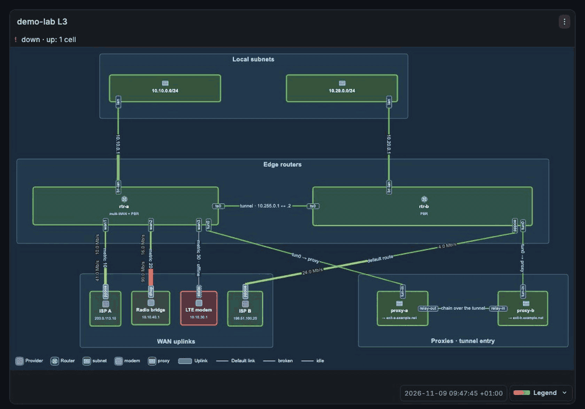
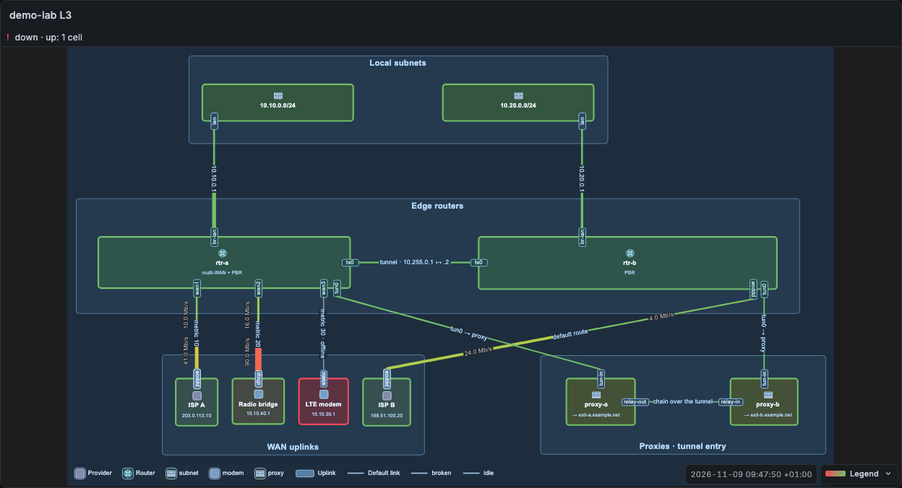
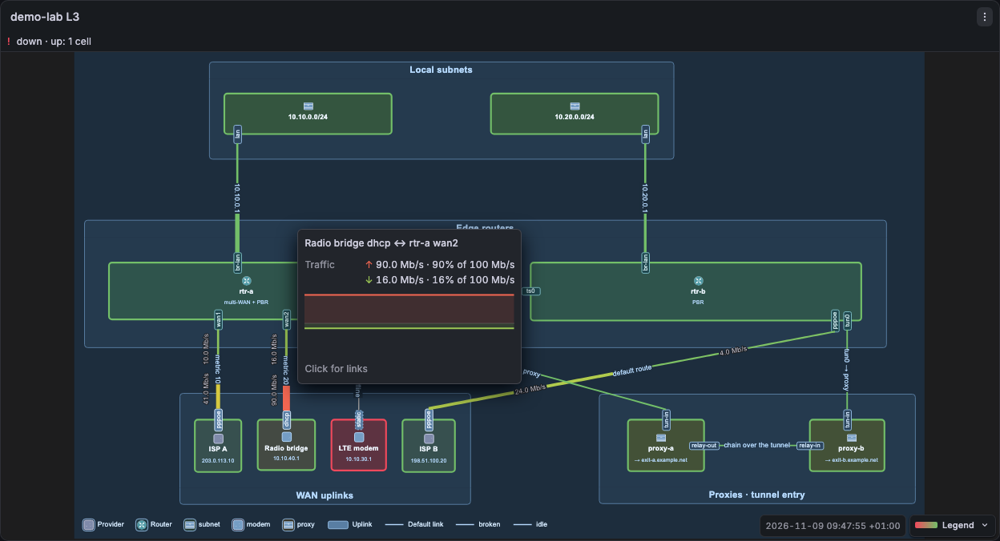
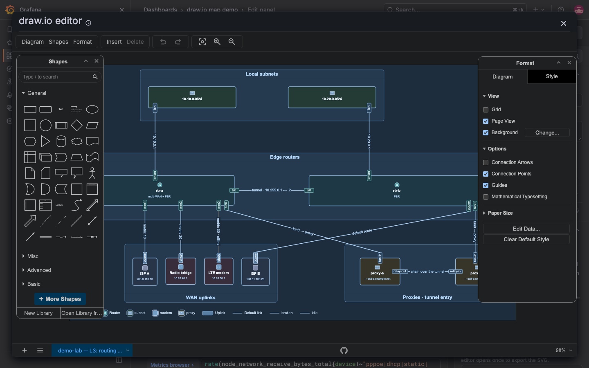

# draw.io map panel for Grafana

A Grafana panel that shows a draw.io diagram as a network weathermap. Queries colour and label the cells.



## What it does

- Colours each link by traffic, for each direction, with an arrow on each half.
- Colours and labels a cell from a status query, with the colours and value mappings of the Grafana field config.
- Opens a hover card with values and sparklines when you point at a cell, or tap it.
- Draws charts and bar gauges inside diagram shapes.
- Opens the real draw.io editor in a modal. View mode loads no draw.io code.

## Requirements

- Grafana 12.4 or later.
- A data source with time series.
- The plugin is not signed. Set `GF_PLUGINS_ALLOW_LOADING_UNSIGNED_PLUGINS=simnv-drawiomap-panel`.

## Install

Download the zip from the [latest GitHub release](https://github.com/simnv/simnv-drawiomap-panel/releases/latest). Restart Grafana after the install.

```bash
grafana cli --pluginUrl https://github.com/simnv/simnv-drawiomap-panel/releases/latest/download/simnv-drawiomap-panel.zip plugins install simnv-drawiomap-panel
```

For Docker and manual install, see [Install](docs/guide/install.md).

## Quick start

1. Install the plugin and restart Grafana.
2. Add a panel and choose the visualisation "draw.io map". Add a query with the refId `up` that returns one series for each host, with the label `job`.
3. In the **Diagram** options, select **Import .drawio** and choose your file.
4. In **Edit bindings**, write a class:

   ```yaml
   version: 4
   classes:
     node-up:
       match:
         key: job
       status: up
   ```

5. Select a cell, choose **Set bind and key**, and set `bind` to `node-up` and `key` to the value of `job`. Select **Apply**.
6. In **Thresholds**, set the base to red and `1` to green. Set **Unit** to `none`.
7. Save the dashboard.

The cell turns green when its host is up.

## Documentation

- [Guide index](docs/guide/index.md): how it works, known limits.
- [Install](docs/guide/install.md): Grafana CLI, Docker, manual.
- [Bindings](docs/guide/bindings.md): import a diagram, classes, match, templates, rows, the match report.
- [Colours, status and legend](docs/guide/colours.md): thresholds, status band, legend.
- [Links](docs/guide/links.md): capacity, arrow styles, value labels.
- [Hover card](docs/guide/hover-card.md): which cells open a card, card titles.
- [Zoom](docs/guide/zoom.md): zoom options, live zoom, minimum scale.
- [Editor](docs/guide/editor.md): the bundled draw.io editor.

## Gallery







## Contributing

See [CONTRIBUTING.md](CONTRIBUTING.md).

## Licence

Apache-2.0. See [LICENSE](LICENSE).

"draw.io" is a trademark of JGraph Ltd. This plugin is not affiliated with JGraph Ltd or with the draw.io project.
