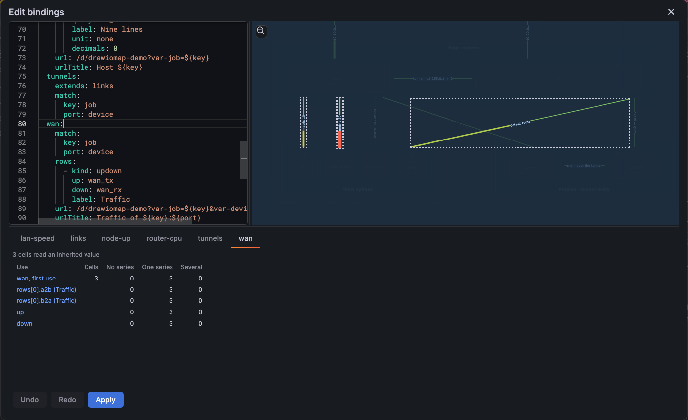
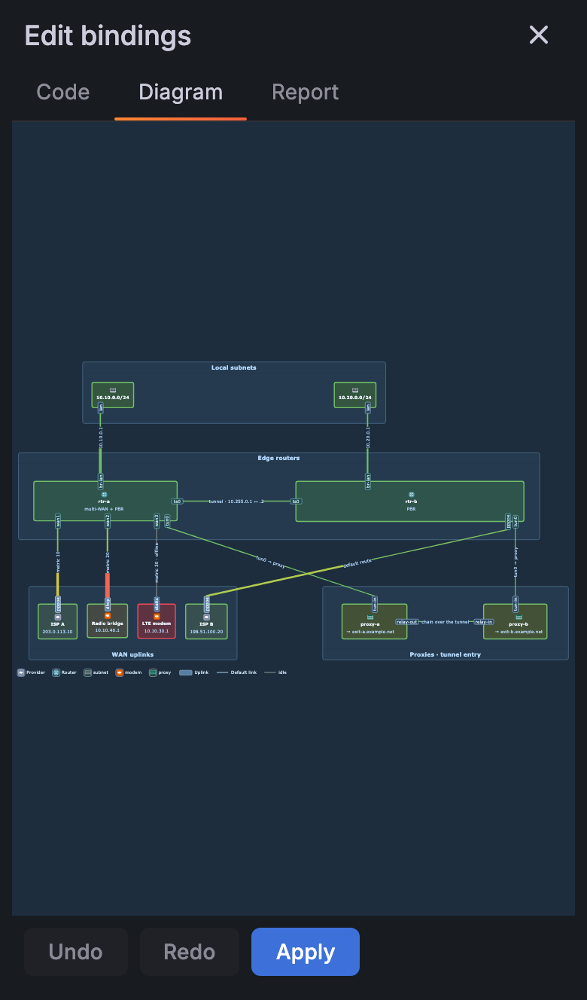
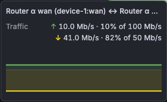

# Bindings

## Diagram import

Open the panel editor and go to **Diagram**. There are three ways to add a diagram:

1. **Import .drawio.** Choose a `.drawio` file, for example a portograph export. The panel loads the file in the editor modal. The editor exports the SVG and the modal closes. The panel stores the XML and the SVG.
2. **Paste draw.io XML.** Paste the XML (from **Extras > Edit Diagram** in draw.io) and select **Apply pasted XML**. The panel accepts an `<mxfile>`, an `<mxGraphModel>`, or an SVG that has an embedded copy of the diagram.
3. **Edit in draw.io.** Draw or change the diagram in the real draw.io editor. A panel without a diagram shows **New diagram** instead. **Save** and **Save & Exit** store the XML and the SVG.

The panel uses these cell attributes to find cells:

- Portograph diagrams use the `pg-*` attributes (`pg-id`, `pg-kind`, `pg-from`, `pg-to`). The contract is in the [portograph contract](../research/portograph-contract.md).
- For a hand-drawn diagram, a cell has its draw.io `id`, its label text and the attributes that you add (see [Cell attributes](#cell-attributes)). See `handDrawnConfigV4` in `src/fixtures/demo-config.ts`.

Only page 1 of a multi-page diagram is shown, and only page 1 is bound. The **Diagram** options show a warning when you import or paste a file with several pages.

## Bindings (v4)

A binding joins a cell of the diagram to the series of the panel queries. The config has **classes**. A class says what its cells show: a status, a text, hover rows, a chart, and for a link the two directions and the capacity. A cell joins a class with its attribute `bind`. Its other attributes (`key`, `port`, and so on) tell which series belong to the cell.

The config is version 4. This is the first panel version that reads it. A config of version 3 or older binds nothing (see [Old configs](#old-configs)).

The queries are the targets of the panel. A class names a target by its **refId** (`A`, `up`, `lan_tx`). The panel runs no query of its own.

```yaml
version: 4
freshness: 3x
classes:
  node-up:
    match:
      key: job
    status: up
    rows:
      - kind: history
        label: load 1m
        query: load
    url: /d/drawiomap-demo?var-job=${key}
  lan-speed:
    match:
      key: job
      port: device
    up: lan_tx
    down: lan_rx
    capacity: speed
    linkLabel: percent
    rows:
      - kind: updown
        label: Traffic
        up: lan_tx
        down: lan_rx
overrides:
  pg-node~proxy-b:
    match:
      key: job="${key}-no-data"
```

A cell with `bind=node-up` and `key=node-rtr-a` shows the series of the target `up` that have the label `job="node-rtr-a"`. A link with `bind=lan-speed`, `key=node-rtr-a` and `port=br-lan` takes the series of the targets `lan_tx` and `lan_rx` that have `job="node-rtr-a"` and `device="br-lan"`. `src/fixtures/demo-config.ts` holds the full demo config; the demo dashboard uses it.

### Edit the config

The option **Bindings** (group **Bindings**) is a YAML editor. The panel stores the config as JSON in the dashboard. The editor shows the same data as YAML in a fixed key order.

The **Edit bindings** button above the YAML opens the [split editor](#split-editor). It is disabled when the panel has no diagram. Outside the panel editor it shows "Open the panel editor first".

- A YAML comment is not kept. The editor writes the config from the data on each load.
- An error shows as a marker on its line. A YAML syntax error and an error in the top level (`version`, `freshness`, `classes`, `overrides`) stop the save: the editor keeps your text and stores nothing. An error inside one class or one override does not stop the save. The panel shows the cells of that class or override as **unavailable**: grey, with the reason "Binding is not valid".
- The editor loads in a separate chunk. View mode and the dashboard do not load the YAML parser.
- The option `build` of the panel JSON is never read by the panel. A generator can write it. The editor keeps it.

### Split editor

In panel edit, select **Edit bindings** on the panel (top-left corner) or in the Bindings options, above the YAML. The split editor opens in a dialog of 96 % of the window width and 94 % of its height, in the middle of the window, the same size as the draw.io editor. On a phone it fills the screen. It shows YAML on the left, a live diagram on the right, and the match report below. On a narrow screen, use the Code, Diagram and Report tabs. Drag the handles to resize the panes. The panel keeps their sizes in the browser. Without a stored size, the report and inspector row takes 40 % of the dialog height, at least 320 px.





The preview follows a valid draft. Move the cursor in YAML to highlight the affected cells; select a report entry to move to its YAML path and highlight its cells. Select a cell to open its inspector and move the cursor to its override or class. A cell with no `bind` and no override has no place in the YAML: the cursor does not move. The inspector shows its class chain, override, `bind` and `key`, and, for an edge, the link section: the ends, the line **Measured end** (which end gives the counters and why), the direction of each half, the capacity of each direction with its source, and, for an unmeasured link, the uses that it does not measure. After that it shows the attributes (an inherited value shows with the cell that gave it) and, for each use, the query, the matchers with the inherited values put in, the end of a directional use, the series count and up to eight label sets and values. An end shows as a name: `node · port` for a portograph port, the label for another draw.io cell, else the cell id. The cell id is the tooltip of the name. End **a** is the source and end **b** is the target, as in the lines `a → b` and `b → a`.

The highlight (from the cursor or a report entry) and the selection are two ways to point at cells, and the highlight dims all other cells. So the highlight ends when you select a cell, box-select, click the empty stage, press **Escape** (when the focus is not in the code box), or use **Undo**, **Redo** or a write. The first **Escape** only ends the highlight; the next one closes the editor.

Set `bind` and `key` for one cell with **Set bind and key**. An empty field removes that attribute. Shift-click cells or drag a selection box with Shift, then use **Assign class** to set `bind` on all selected cells; their keys stay. For an edge, the inspector says which end the key names (for example "The key names the target end (rtr-a · br-lan)."). Use **Use the target end** or **Use the source end** to write `at=target` or `at=source`. The button always writes the end it names, also when the link would infer that end. An own `at` also sets the feed of the uses that match on the link itself, so a cleared `at` could change them. When the link has `at`, **Infer the end** removes it. On a generated panel the inspector says that the generator writes `at` again at the next build; change the link in the generator source. These writes change page 1 of the draft diagram in both XML and SVG. If the page is compressed (a diagram that a plugin version before 1.5.3 stored), open it in draw.io and save it once before a write.

Use **Undo** and **Redo** for diagram writes. Ctrl+Z (Cmd+Z on a Mac) undoes the text when the code box has the focus; in other places it undoes the last diagram write. **Apply** saves the valid YAML and diagram draft to the panel options; the text "Applied to the panel. Save the dashboard to keep it." shows next to the button until the draft changes again. Save the dashboard to keep the changes. **Apply** is off while the YAML does not parse. An error in one class or one override does not turn it off. Closing with an unapplied draft asks for confirmation. If the saved panel changes while the editor is open, choose **Reload** to discard the draft or **Keep my draft** before applying it.

#### Completion

The code box suggests names while you type. It sends no query: it reads the loaded series and the cells of the diagram.

- **Keys.** Inside a class, an override, a row, `text` or a `chart`, it suggests the keys of that map. For a row or a chart with a `kind`, it suggests the keys of that kind.
- **Class names.** After `extends:`, it suggests the other classes of the draft.
- **RefIds.** For `status`, `up`, `down`, `capacity` (also `a2b` and `b2a`), `text.query` and the `query` of a row or a chart, it suggests the refIds of the loaded series.
- **Cell attributes.** On the left of a `match` entry, it suggests the attribute names of the cells of the class and of the classes that extend it. In an override, it suggests the attribute names of that cell.
- **Labels.** In a matcher value, it suggests the label names of the series of the query that the use reads. After `="` it suggests the values of that label. A value that plain YAML cannot hold is written in quotes.
- **Placeholders.** After `${`, it suggests the attribute names, then `from.` and `to.`.
- **Arrow.** `arrow` shows its help on hover, and its values (`point`, `triangle`, `none`) come with the same help.

The **bind** field of the inspector also suggests the names of the classes of the draft. The same list serves **Assign class**.

### Cell attributes

A cell has attributes: the `data-meta-*` attributes of the exported SVG, written by draw.io, or by portograph from the `meta` of a node. The panel reads page 1 only.

Attribute names are lowercase ASCII. The editor writes them in lowercase (`setCellAttrs` also replaces case variants and removes all variants for `null`).

| Attribute  | Use                                                                                                                                                               |
| ---------- | ----------------------------------------------------------------------------------------------------------------------------------------------------------------- |
| `bind`     | The name of the class of the cell. No `bind`: no binding. A `bind` that names no class gives `unknown-class`.                                                     |
| `key`      | The main identity of the cell, for example a host name or an interface name. The class `match` and the templates read it.                                         |
| `port`     | A second identity, for example the interface of a host. Use any other name for a third one.                                                                       |
| `at`       | A link only. `at=target` selects the target end as the measured end. `at=source` selects the source end. No `at`: the panel infers the end (see [Links](#links)). |
| `cap`      | A link only. The capacity when the class has no `capacity` series: `1G`, or `50M/10M` for a→b/b→a (see [Capacity](links.md#capacity)).                            |
| `capacity` | A link only. The second name of `cap`, as in the portograph contract: same grammar. `cap` wins when both are set.                                                 |
| `id`       | The draw.io cell id. Read it as `${id}`.                                                                                                                          |
| `label`    | The label of the cell. Read it as `${label}`.                                                                                                                     |
| other      | Any name of letters, digits, `_` and `-`. The names `pg-*` belong to portograph.                                                                                  |

The inspector can write `bind` and `key`, and can set or clear `at=target` on an edge. For other attributes:

- The generator or the `meta` of the portograph source writes them.
- You set them in draw.io with **Edit Data** (Ctrl+M) in the embedded editor: **Diagram → Edit in draw.io**, select the cell, press Ctrl+M, add the attribute, then **Save**.

#### Inherited names

A cell does not need all its identity itself. The panel reads a name from the cell, then from its **owner chain**:

- A portograph port cell has its node cell as owner. A port without `key` reads the `key` of its node.
- A shape inside a container has the container as owner, and that container has its own container, up to the layer.
- The first cell that has the name gives the value. An empty value counts as present.

These names are **own-only**: the cell must carry them itself. The panel never reads them from an owner or from an end of a link: `bind`, `at`, `cap`, `capacity`, `id`, `label` and each name `pg-*`. A port does not join the class of its node, and it does not read the `cap` of its node.

No name is special. `key` and `port` follow the same rule as `job` or `device`. The panel does not read `pg-port` as the value of `port`: write `port` on a port that has counters. This is the mark "this interface has counters".

The inspector shows each inherited value with the cell that gave it, for example `key  node-rtr-a  (from rtr-a)`.

A link does not read the container of its edge. A link gets its identity from its ends (see [Links](#links)).

A dashboard that a generator wrote is **generator-owned**. The generator writes its classes, its overrides and its attributes again at each build. A hand edit of them in the panel is lost at the next deploy, unless the generator reads it back first (its `pull` step). Change a generated panel in the generator source.

**Page 1 only.** A diagram with several pages shows page 1, and v4 binds page 1 only. A cell on another page stays unbound. A diagram whose page is compressed (stored by a plugin version before 1.5.3) gives no ends for ordinary links (`no-edge-ends`): open it in draw.io once and save it.

### Classes

A class is a map. Every field is optional.

| Field        | Meaning                                                                                                                                                                                                  |
| ------------ | -------------------------------------------------------------------------------------------------------------------------------------------------------------------------------------------------------- |
| `extends`    | The name of one parent class. See [Extends and overrides](#extends-and-overrides).                                                                                                                       |
| `match`      | Which series belong to a cell: a map from a cell attribute to a series label. See [Match](#match). A class with no `match` is **abstract**: a base for other classes. A cell that binds it gets no data. |
| `status`     | The refId whose value gives the colour and the text of the cell (see [Status, colour and text](#status-colour-and-text)).                                                                                |
| `missing`    | `nodata` (the default, grey) or `down`. What a cell shows when the status query is ready and has no series for the cell.                                                                                 |
| `text`       | `{ query, match, reduce, label, unit, decimals }`. Writes the formatted value on the cell. `query` is a refId.                                                                                           |
| `rows`       | The rows of the hover card (see [Rows](#rows)).                                                                                                                                                          |
| `chart`      | A chart in the box of the cell (see [Chart regions](#chart-regions)).                                                                                                                                    |
| `freshness`  | When a result is stale: `5m`, or `3x` for three times the cadence of the query. The top-level `freshness` is the default; the panel default is `3x`.                                                     |
| `url`        | The main link of the card. A template. `urlTitle` is its title.                                                                                                                                          |
| `up`, `down` | A link only. The refIds of the transmit and the receive counter.                                                                                                                                         |
| `capacity`   | A link only. A refId of the port speed, or `{ a2b, b2a }` for one refId for each direction.                                                                                                              |
| `linkLabel`  | A link only. `none` (the default), `value` or `percent` (see [Link value labels](links.md#link-value-labels)).                                                                                           |
| `arrow`      | A link only. `point` (the default), `triangle` or `none` (see [Arrow styles](links.md#arrow-styles)).                                                                                                    |

`up`, `down`, `capacity`, `linkLabel` and `arrow` on a class whose cells are not links give one `unused-field` entry.

### Extends and overrides

`extends` names one parent. The chain resolves from the root. `rows` append: the rows of the parent come first. Each other field replaces the field of the parent as a whole, so `match`, `chart` and `capacity` are each one field. A cycle, an unknown parent and a parent that is not valid make the class invalid, and the classes below it.

`overrides` change one cell. The key is the draw.io cell id. An override has the fields of a class, except `extends`. It applies after the class chain, with the same rule: rows append and the other fields replace. Use it for the rare exception. An override for a cell id that the diagram does not have gives `unknown-override`. An invalid override makes its cell unavailable.

An invalid class, and the classes below it, make their cells unavailable. The other classes bind as usual.

### Match

`match` is a map. The key is a **cell attribute**. The value says which series label must agree with it.

| Form                                       | Meaning                                                                             |
| ------------------------------------------ | ----------------------------------------------------------------------------------- |
| `key: job`                                 | The series label `job` equals the attribute `key` of the cell.                      |
| `key: instance=~"${key}:.*"`               | The label `instance` matches the regular expression `^(?:<value of key>:.*)$`.      |
| `port: device`                             | A second pair: the label `device` equals the attribute `port`.                      |
| `key: entity="switch.${key}_k${port}"`     | A template. It reads any attribute of the cell; each one that it reads is required. |
| `key: [instance=~"${key}:.*", job="node"]` | A list. All matchers must pass.                                                     |

#### Read the end cells of a link

A matcher value can read an attribute of the cell at one end of a link: `${from.name}` for the source end and `${to.name}` for the target end. The panel looks for the attribute in the end cell first. If the end cell does not have it, the panel looks in the next cell: for a port cell, its node cell; for a shape inside a container, the container; and so on up to the layer. The first cell that has the attribute gives the value. If no cell has it, the cell gets `missing-attr`.

This is the explicit form. It stays valid, but it is no longer the usual way to bind a portograph link. Put `key` on the node, `port` on the port and `bind` on the link, and the panel reads the ends itself (see [Links](#links)). Use `${from.…}` and `${to.…}` when you want one fixed geometric end, whatever the panel infers. A portograph link that has only `bind` can use this form too. The link has no `key` and no `port`, but its ends do:

```yaml
classes:
  lan:
    match:
      id:
        - job="${from.job}"
        - device="${from.device}"
    up: lan_tx
    down: lan_rx
```

The record key is `id`. A record key must be an attribute that the cell has, and every cell has `id`. The value does not read it: each matcher reads only `${from.…}`. The key only makes the block valid.

`${from.…}` always names the source end and `${to.…}` always names the target end. They do not follow the measured end, and they also read the own-only names (`${from.pg-port}`, `${from.label}`). To measure the other end, read `${to.…}` in the values and set `at=target` on the link (see [Links](#links)). Then the halves a→b and b→a follow the end that you measure.

A row, `text` and `chart` can have their own `match`. It replaces the `match` of the class as a whole; it does not add to it. A filter that does not depend on a cell belongs in the query, not in `match`.

In YAML flow style (`{…}`, `[…]`) a plain value cannot hold `{`, `}`, `[`, `]` or `,`. Write `match` in block style, as above, or in single quotes. The editor writes block style.

#### The matcher contract

The panel runs one matcher in these steps.

1. **Parse.** The text is `<label>` or `<label><op>"<string>"`. `<label>` is `[A-Za-z_][A-Za-z0-9_]*`. `<op>` is `=`, `!=`, `=~` or `!~`. Only double quotes are allowed. Space around the parts is allowed. A text that does not parse is a `schema` entry.
2. **Unescape.** The string uses the Go escapes of PromQL: `\\`, `\"`, `\n`, `\t`. Another backslash sequence is a `schema` entry. Thus `entity=~"\\d+"` gives the body `\d+`, and `"\d"` is an error, as in PromQL.
3. **Find the placeholders.** A matcher reads `${name}`, `${from.name}` and `${to.name}`. Each one is a required attribute. `${labels.x}`, `${value}` and a dashboard variable (`${name:format}`) are a `schema` entry in a matcher. A matcher reads no dashboard variable: put such a filter in the query.
4. **Required attributes.** The record keys and the placeholders are required. A cell that lacks one gets `missing-attr`, and that use selects no series for the cell. An empty value counts as present.
5. **Substitute.** `=` and `!=` take the value as it is. `=~` and `!~` regex-escape it first. A quote or a backslash in a cell value cannot change the matcher.
6. **Compile.** The regex dialect is the part of RE2 (PromQL) and JavaScript that means the same in both. The panel rejects, with `matcher-error`: `\A`, `\z`, `\Q…\E`, `\C`, `\p`, `\P`, `(?P<`, a flag group other than one leading `(?i)`, lookaround, and backreferences. A `\` and an ASCII punctuation character is that literal character (`\-`, `\_`, `\:`). Another unknown escape (for example `\y`) is a `matcher-error`. A regex is anchored: `^(?:…)$`. `.` does not match a line break.
7. **Test.** The test reads the whole label value. An absent label is the empty string, as in PromQL: `job!="x"` and `job=""` pass on a series with no `job`; `job="x"` fails.
8. **Combine.** All matchers of a block must pass.

A block must read the cell: a bare matcher, or a placeholder. `match: {}` and `match: { key: job!="" }` are `schema` entries, because they select the same series for every cell.

When the result of a query has no label that names the cell, change the query so that it keeps one, for example `min by (entity) (…)`.

### Templates

A template is the text of `url`, `urlTitle`, a `metadata` row and a `drilldown` row, and the string of a matcher. The scope:

| Placeholder                  | Value                                                                                                                      |
| ---------------------------- | -------------------------------------------------------------------------------------------------------------------------- |
| `${name}`                    | The attribute `name` of the cell. `${id}` is the cell id. `${label}` is the attribute `label`.                             |
| `${from.name}`, `${to.name}` | An attribute of the cell at the source or target end of a link. They do not follow the measured end (see [Links](#links)). |
| `${name}` on a link          | The link itself, else the owner chain of its measured end (see [Links](#links)).                                           |
| `${labels.name}`             | A label of the status series of the cell. Only when the status use selects exactly one series.                             |
| `${value}`                   | The formatted status value. The same condition.                                                                            |

`${name}` is always a cell attribute. There is no `cell.` prefix. A missing attribute is a `missing-attr` entry, never a dashboard variable: the item is not shown. `${labels.x}` and `${value}` with no series or many series give `template-unresolved`. A `${` that starts none of the forms here and no `${name:format}` is a `schema` entry in a URL, a `metadata` text and a `drilldown`. `${__name}` is a cell attribute; write `$__name` for a Grafana variable.

**Dashboard variables.** The panel does not substitute them. Grafana does (`replaceVariables`), and only in a URL and in a title (`urlTitle`, the label of a `drilldown`).

| Form               | Meaning                                                                                                                                                           |
| ------------------ | ----------------------------------------------------------------------------------------------------------------------------------------------------------------- |
| `$name`, `$__name` | A dashboard variable, or a Grafana global variable.                                                                                                               |
| `${name:format}`   | A dashboard variable with a Grafana format: `csv`, `pipe`, `regex`, `queryparam`, `percentencode`, `raw`, `text`, and so on. The panel does not check the format. |

A `${name:format}` in a `metadata` text is a `schema` entry: a `metadata` text reads no dashboard variable.

**The URL encoding.** For a URL the panel works in this order:

1. It replaces each placeholder of the scope table with the value, encoded with `encodeURIComponent`. A `$` in a cell value is shielded, so `replaceVariables` does not expand an attribute that holds `${site}`.
2. It writes each bare variable `$name` as `${name:percentencode}`. A name that starts with `__` stays as it is: `$__url_time_range` gives `from=…&to=…`, unencoded. A `${name:format}` keeps its format.
3. `replaceVariables` runs. Then the panel removes the shield and checks the final text. A URL that is not relative and not `http` or `https` is not shown.

Thus `/d/host?var-job=$job` with the value `a&var-site=b` gives `var-job=a%26var-site%3Db`. A multi-value variable in the bare form gives one encoded value, not several parameters; the exact text is the output of the Grafana format `percentencode`. To get repeated parameters write `/d/host?${job:queryparam}`: the result is `var-job=a&var-job=b`. A cell attribute `job` and the variable `job` do not clash: `${job}` is the attribute, `$job` and `${job:queryparam}` are the variable.

### Status, colour and text

`status` names a refId. The field config of that refId in the panel (thresholds, value mappings, colour scheme, unit) gives the colour and the text of the cell. The cell shows the **exact** colour and text of its series. A value mapping that maps `1` to the text `Offline` in magenta paints the cell magenta with the text `Offline`.

- Severity decides only three things: the worst of N series, the status band and the legend. A mapping text `down` (any case) gives `down`. Else the colour name decides: `red*` is critical, `orange*` and `yellow*` are warning, the rest is normal. A hex colour goes to the nearest hue of the Grafana palette.
- A cell with several series shows the worst by this rank: down, critical, warning, stale, missing, normal. At one rank, the first series in the [fixed order](#several-series) wins.
- A field config can map a value to the colour `transparent`. Then the panel paints nothing and the cell keeps its drawn colour. A generator writes `transparent` for each healthy value. A hand author can choose green.
- The hover card and the status band show the text. A cell without a value has the text `–`; its reason shows in place of it.

The paint itself is in [Status paint](colours.md#status-paint).

### Missing data

The state of a use comes from the result of its refId.

| Result                                                          | The cell shows                              | `missing: down` |
| --------------------------------------------------------------- | ------------------------------------------- | --------------- |
| The query failed, or the whole request failed                   | grey, "Query failed" (`query-unavailable`)  | does not apply  |
| First load, no series yet                                       | grey, "Loading data"                        | does not apply  |
| A refresh is loading                                            | the last series (Grafana keeps them)        | as ready        |
| A refId that no panel target has                                | grey, "Unknown query" (`unknown-ref`)       | does not apply  |
| Ready, zero series for the cell                                 | grey, "no data"                             | `down`          |
| Ready, a series with no finite value (all null, NaN, ±Infinity) | that series is `missing`, "No value"        | does not apply  |
| Ready, a field that fails the frame checks                      | that series is `missing` (`invalid-series`) | does not apply  |

A missing value never shows as a good state. A special-value mapping of Grafana (null → green) does not apply. With two series, one with the value 1 and one with no value, the cell is `missing` with the reason "1 of 2 series have no value". `missing: down` applies only to zero series of a ready query. A module with 5 of 6 series shows the worst of the 5.

### Freshness

A series is **stale** when its last non-null value is older than the freshness. A cell is stale when one of its series is stale.

- `5m` is a fixed time. `3x` is three times the cadence of the query. The cadence is the larger of the request interval and the minimum interval of the target; without both, it is the median step of the series. A series with fewer than two points then has no stale check.
- A target with `instant: true` and no `range: true` is never stale. A dead exporter goes to no data through the lookback of the data source.
- On a relative time range (`now`, `now-1h`) a cell turns stale at its time with no new data. The age counts from the clock, less the lag of the range end. On an absolute range the age counts from the end of the range, and the state does not change with the clock.
- Freshness applies to the status and to the rows (a row shows "stale"). It does not apply to the capacity.

### Several series

A use can select more than one series.

**Order.** The series of a use are in one fixed order: by the label string (`k="v"` pairs, keys sorted), then by frame order, then by field index. "First", "+N more" and the colour of a line use this order. A frame with more than one numeric field gives `many-fields`. Two frames with equal labels and field name are one series: the panel merges their samples by time, so a target with `instant` and `range` gives the range points and then the instant point. Two different values at one time give `duplicate-series`.

| Use                          | With N series                                                        |
| ---------------------------- | -------------------------------------------------------------------- |
| `status`                     | the worst state                                                      |
| `text`, `value` row or chart | reduce across the series; `many-series` unless the use sets `reduce` |
| `history` row or chart       | up to 8 lines, then "+N more"                                        |
| `updown` row or chart        | reduce each direction; `many-series` unless the use sets `reduce`    |
| `up`, `down` of a link       | reduce with the default; `many-series`                               |
| `capacity`                   | not used, falls through; `many-series`                               |

**`reduce`.** `sum`, `max` or `mean`. The default is `sum` when the unit is a rate unit (`bps`, `Bps`, `pps`, `cpm`, `flowlpm`, and the other units of the Grafana categories "Data rate", "Throughput" and "Flow"), else `max`. An explicit `reduce` says that N series are expected, so the report stays quiet.

**Units.** When the units of the series differ and all are bit or byte rates, the panel converts to the unit of the first series: 1 Mbit/s and 500 kbit/s sum to 1.5 Mbit/s. Other mixed units give `missing` with "Mixed units" and `unit-mismatch`.

**N lines.** A `history` row or chart draws up to 8 lines in one chart with one Y range. A line shows only the labels that differ between the lines; when no label differs, it shows the display name of the field. The 8 lines have 8 distinct colours of the Grafana classic palette (slots 0–5, 26 and 30), in the fixed order. A series with no value keeps its place and colour and shows "No data" in the tooltip.

### Rows

`rows` is a list. A row is one line of the hover card.

| `kind`      | Fields                                                       | Meaning                                                               |
| ----------- | ------------------------------------------------------------ | --------------------------------------------------------------------- |
| `history`   | `query`, `match`, `label`, `unit`, `decimals`, `min`, `max`  | A value and a sparkline. `min` is a number or `auto`; `max` a number. |
| `value`     | `query`, `match`, `reduce`, `label`, `unit`, `decimals`      | A reduced value.                                                      |
| `updown`    | `up`, `down`, `match`, `reduce`, `label`, `unit`, `decimals` | Two directions of one subject in one chart (see below).               |
| `metadata`  | `label`, `text`                                              | A text from a template. It reads no dashboard variable.               |
| `drilldown` | `label`, `url`                                               | A link in the footer of the card.                                     |

The label, unit and decimals come from the field config of the refId. A row can override them. Rows of different units can share one card.

An `updown` row draws the two directions in one chart: up above a zero line, down mirrored below it, in one symmetric range. The colour and the text of each direction follow the rules of a link half (see [Links](#links)).

### Sparkline Y range

All sparklines use one Y range: card rows and chart regions. A series without negative values starts at 0, so a small change on a flat series does not look like a big climb. The top is the largest value, the capacity, or 100 for the unit `percent` (1 for `percentunit`), whichever is largest. A series with negative values uses its own min and max. The lines of one chart share one range.

Each bound uses the first source that has a value:

1. `min` and `max` of the row or the chart.
2. **Min** and **Max** of the Grafana field config.
3. The default above.

The bounds are soft: the range always holds all values. Set `min: auto` to use the data range instead of the zero baseline. The span is then at least 10% of the largest value, centred on the data.



```yaml
rows:
  - kind: history
    label: PoE power
    query: poe
    min: auto
```

### Chart regions

The class field `chart` draws a chart in the box of each of its cells. It has the fields and the rules of a row of the kind `history`, `value` or `updown`. A `value` chart is a bar gauge. Draw a rectangle in the diagram, give it `bind` and `key`, and bind a class with a `chart`.

```yaml
classes:
  cpu-chart:
    match:
      key: job
    chart:
      kind: history
      query: cpu
      unit: percent
```

### Links

A class with `up`, `down` or `capacity` applies to a link (an edge cell).

- The ends of a portograph link come from `pg-from` and `pg-to`. An ordinary draw.io edge has its ends in the `source` and `target` of its cell in page 1 of the stored XML. An attribute on the port cell wins over the same attribute on the node cell. When the end cell has no such attribute, the panel looks in its parents up to the layer (a shape inside a container). `${from.key}` and `${to.key}` read the attribute at an end. A matcher can read any attribute at an end: see [Read the end cells of a link](#read-the-end-cells-of-a-link).
- The half at the start of the drawn path is **a→b**. The matched attributes name the interface at the measured end (see below). With the source as measured end, a→b takes `up` (transmit) and b→a takes `down` (receive). With the target as measured end (`at=target`, or inferred), a→b takes `down`. The stroke of each half, the link value label and the `updown` row of the card follow the same rule.
- With a capacity, the colour input is the percent of the capacity. Without one, it is the raw value. See [How colours and thresholds work](colours.md#how-colours-and-thresholds-work).
- For the capacity, see [Capacity](links.md#capacity).

#### A link reads its identity from an end

Write the identity once, on the thing that owns it:

- `key` (or `job`, `device`) on the **node**.
- `port` on the **port cell**, only on a port that has counters.
- `bind` on the **link**. The link needs no other attribute.

The panel reads each query use of the link (status, text, rows, chart, `up`, `down`, `capacity`) with its own `match`. A use is **end-free** when the link has all the names of its match itself (for example a row with `match: {id: edge}`). Such a use works as before. Each other use is **dependent**: it needs names that the link lacks. The **identity names** are these names, for all dependent uses of the link.

The **measured end** is the end whose interface gives the counters. The panel selects it with the first rule that applies:

| Order | Condition                                                          | Measured end                                       |
| ----- | ------------------------------------------------------------------ | -------------------------------------------------- |
| 1     | The link has `at`.                                                 | The target for `at=target`, else the source.       |
| 2     | The link has no dependent use.                                     | The source.                                        |
| 3     | Only one end gives all the identity names that the link lacks.     | That end.                                          |
| 4     | Both ends give them.                                               | The source.                                        |
| 5     | No end gives them, and the link has a part of the identity itself. | The source. The missing names give `missing-attr`. |
| 6     | No end gives them, and the link has no identity name.              | None: the link is **unmeasured**.                  |

An end gives the names when its end cell, or the owner chain of that cell, has each missing name. An own attribute of the link wins over the same name on the end. The own-only names come from the link only.

The feed follows the end. A directional use that needs an end (`up`, `down`, an `updown` row or chart) reads the counters at the measured end. With the target as measured end, a→b takes `down`, as for `at=target`. A use whose match resolves on the link itself keeps the source feed. For example, a row with `match: {id: edge}` keeps the source feed when the halves infer the target. The inspector shows the end of each use.

`${key}` in a template of a link reads the measured end. `${from.key}` and `${to.key}` keep their geometric meaning.

The capacity can also come from the end: see [Capacity](links.md#capacity). A `capacity` query that resolves through the end wins over the `cap` of the link, as any capacity query does.

**An unmeasured link** has dependent uses, no `at`, no identity name and no end that gives the names. The panel is quiet about it: its dependent uses give no warning and no grey half. Its end-free uses and its templates that need no identity name still work. A link with only `bind` between two cells without counters gets no patch and no card. The report has one `unmeasured-link` entry for each class and name set (information, not a warning).

**When both ends qualify**, the source wins. This is safe when both ends have series for the queries of the class, and for a tunnel. It is not safe when the two ends use different exporters. Then the source can have no series, and the report has `end-ambiguous`. There are two fixes:

- Set `at=target` on the link.
- Give the attribute a name that follows the exporter family: `device` on the ports of one family and `port` on the ports of the other. Then the match of the class finds only one end.

**Exceptions.**

- A counter on a VLAN interface or a tunnel: write `port` (the name of that interface) on the link. The link keeps this `port` and reads `key` from the node at the end.
- A port with two links and one counter for each link: write the identity on each link.
- An anonymous port has no cell. The link reads the node cell.
- A split link (`pg-run`) is not tested. A run with `pg-from` and `pg-to` resolves as the other runs. A run without them can be unmeasured.

An ordinary draw.io edge works the same way: its ends are `source` and `target` in page 1, and a shape reads its container.

#### A port class

A port cell can bind a class itself. A port with `bind` and its own `port` reads `key` from its node. So a port class with `status`, `text`, `chart` or an `updown` row binds the counters of the interface, with no copy of the node identity. This is the way for a bus that has no link cell. `up`, `down` and `capacity` still need a link (a port gives `unused-field`).

### The match report

On each bind the panel collects a **report**. In view mode the warning badge in the corner shows the number of grouped causes. Its tooltip uses the same cause text and short use names as the editor. In panel edit, use **Edit bindings** to open the split editor and its report. The YAML option shows the entries of the parse as markers on their lines. Each entry names a YAML path, a set of cells, or both.

The report of the split editor has one tab for each class, in the order of the config. A tab shows the cell counts of the class and its entries. The number after the class name is the number of grouped causes. The entries that have no class (for example a YAML error, `unknown-class`, `unknown-override` or `orphan-series`) are in the last tab, **Not in a class**. The report opens the first tab that has entries. When you move the cursor into a class, or select a cell, the report opens the tab of that class. The cursor in `overrides` opens **Not in a class**. To move between the tabs with the keyboard, focus a tab and use the arrow keys, Home and End.

The report groups entries only for display. The bind keeps every per-path entry for YAML markers and other tools.
For example, one missing `key` on three cells gives one row, **3 cells have no attribute `key`**.
The secondary line lists the uses, such as `status`, `rows[0] (load 1m)`, `url` and `urlTitle`.
Select a use to move the cursor to its full YAML path and highlight its cells.
Select the cause text to select the first use and the same cells.
Class tabs omit the `classes.<name>.` prefix for their own uses. Inherited uses keep the source class, such as `base.rows[0]`.
A row shows its configured label when it has one. The source class keeps inherited rows distinct when their labels are equal or absent.
Override paths stay explicit because they name a different cell.

Within each tab, `missing-attr`, `unknown-ref`, `matcher-error` and `no-series` come first, in that order.
Unmeasured link information comes after all warnings. It is absent from the view badge and the class tab count.
The other causes, including `bad-cap` and `cap-conflict`, keep their original order. Uses within one cause also keep their original order.
The summary columns **No series**, **One series** and **Several** count cells with zero, one and more than one series.
The class summary uses each cell's first use. The rows below it count each use separately.

Every group key includes the kind, class and same cell set. Cell order does not affect the key.
The following table gives the extra cause key. Different keys stay in separate rows.

| Kind                                                                                   | Extra cause key                                   |
| -------------------------------------------------------------------------------------- | ------------------------------------------------- |
| `unmeasured-link`                                                                      | Same identity name set, in any order              |
| `end-ambiguous`                                                                        | None                                              |
| `missing-attr`                                                                         | Attribute name                                    |
| `unknown-ref`                                                                          | refId                                             |
| `matcher-error`                                                                        | Matcher text and error message                    |
| `no-series`, `template-unresolved`, `unused-field`, `class-no-match`, `class-no-cells` | None                                              |
| `many-series`                                                                          | Same cell id and series count pairs, in any order |
| `unit-mismatch`                                                                        | Same unit set, in any order                       |
| `capacity-fallback`, `no-edge-ends`                                                    | Reason                                            |
| `bad-cap`                                                                              | Attribute name (`cap` or `capacity`) and value    |
| `cap-conflict`                                                                         | Both attribute values, `cap` and `capacity`       |
| `class-cycle`, `class-unknown-parent`, `class-invalid-parent`                          | None                                              |
| `unknown-class`                                                                        | Bind name                                         |
| `unknown-override`                                                                     | Cell id                                           |
| `schema`                                                                               | Full YAML path and message                        |
| `yaml`                                                                                 | Line and message                                  |
| `outdated-config`                                                                      | Version                                           |
| `query-unavailable`                                                                    | refId, state and message                          |
| `many-fields`, `invalid-series`                                                        | refId and message                                 |
| `orphan-series`                                                                        | refId, label sets and overflow count              |
| `duplicate-series`                                                                     | refId and labels                                  |

| Entry                                                         | Meaning                                                                                                                           |
| ------------------------------------------------------------- | --------------------------------------------------------------------------------------------------------------------------------- |
| `schema`                                                      | A field has a wrong name, type or form. The entry gives the YAML path.                                                            |
| `yaml`                                                        | A YAML syntax error. The editor only.                                                                                             |
| `outdated-config`                                             | The config has version 3 or older.                                                                                                |
| `class-no-match`                                              | Cells bind a class that has no `match`.                                                                                           |
| `class-cycle`, `class-unknown-parent`, `class-invalid-parent` | The chain of `extends` has an error. The class and the classes below it are invalid.                                              |
| `unknown-ref`                                                 | No panel target has this refId.                                                                                                   |
| `unknown-class`                                               | Cells have a `bind` that names no class.                                                                                          |
| `unknown-override`                                            | An override names a cell id that the diagram does not have.                                                                       |
| `missing-attr`                                                | A cell lacks an attribute that the match or a template reads.                                                                     |
| `matcher-error`                                               | A regex is not in the dialect, or does not compile.                                                                               |
| `template-unresolved`                                         | `${labels.x}` or `${value}` found zero or many series.                                                                            |
| `query-unavailable`                                           | A query failed or is loading.                                                                                                     |
| `unmeasured-link`                                             | No end gives the identity names. This entry is information. Select it to highlight the links.                                     |
| `end-ambiguous`                                               | Both ends give the identity, but no dependent use selects a series at the source. Check the target and set `at=target` if needed. |
| `no-series`                                                   | Cells have no series for a use.                                                                                                   |
| `many-series`                                                 | A use found more than one series where one is expected.                                                                           |
| `orphan-series`                                               | Series that no cell selects. The entry lists 50 label sets at most, then "+N more".                                               |
| `many-fields`, `invalid-series`                               | A frame has more than one numeric field, or a field fails the checks.                                                             |
| `duplicate-series`                                            | Two frames hold different values at one time for equal labels.                                                                    |
| `unit-mismatch`                                               | The units of the series cannot convert to one unit.                                                                               |
| `capacity-fallback`                                           | The capacity series cannot give a value (the reason says why); the next source applies.                                           |
| `bad-cap`                                                     | The attribute `cap` (or `capacity`, when `cap` is absent) does not parse.                                                         |
| `cap-conflict`                                                | The attributes `cap` and `capacity` are both set and differ. `cap` is used.                                                       |
| `no-edge-ends`                                                | The ends of an ordinary edge are not readable (a compressed page).                                                                |
| `unused-field`                                                | A link field on a class whose cells are not links.                                                                                |
| `class-no-cells`                                              | No cell binds this class or a class that extends it. An abstract class gives none.                                                |

`no-series` and `orphan-series` are how you find a wrong `match`.

### Hand-authored panels

A generator writes an explicit list of hosts in each query (`job=~"node-rtr-a|node-hv-a|node-ctl-a"`). By hand, a new host would need an edit of every target. A hand-authored panel uses **open selectors** instead (`job=~"node-.*"`) and relies on the report. `orphan-series` shows a series that has no cell, and `no-series` a cell that has no series. The cap of 8 lines and of 50 orphan label sets keeps an open selector safe.

### Supported query results

Finite Grafana data frames with one numeric field per series support histories. Null gaps keep their meaning. Empty, single-sample, failed and stale histories show text. Logs, traces, legacy datapoint objects, streaming or partial frames, ambiguous numeric fields and invalid timestamps give a report entry. A query result does not inherit panel transformations or field overrides of other panels: use the field config of this panel.

Only the Prometheus and TestData plugins of the [tested matrix](../research/authoring-compatibility.md) have browser evidence.

### Old configs

This plugin has no migration code.

- A config with `"version": 3` or lower loads, the diagram renders, the panel binds nothing and shows one note: `This configuration has version 3. The panel reads version 4 only: write the config again as version 4.` Write the config again as version 4, or regenerate it.
- The option `rules` of version 1 is gone. A dashboard that still has it loads. The panel ignores the rules and shows one warning: `The panel ignores N rules of version 1. Write the bindings again as a version 4 config.` The saved value stays in the dashboard JSON until you remove it.
- An old `editorUrl` value is ignored (see [Editor](editor.md)).

Back up the dashboard JSON before you change a config.
