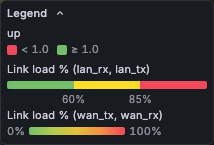
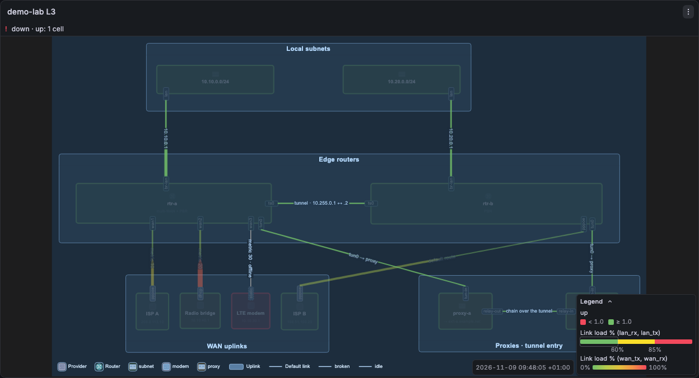
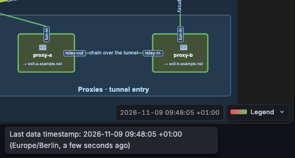

# Colours, status and legend

## How colours and thresholds work

The panel has no colour settings of its own. It uses the standard field config of Grafana, as all Grafana panels do:

- **Standard options → Color scheme**: for example **From thresholds**, **Single color**, **Classic palette** or a continuous scheme such as **Green-Yellow-Red (by value)**.
- **Thresholds**: the steps and their colours.
- **Standard options → Min** and **Max**: the Y range of the charts (see [Sparkline Y range](bindings.md#sparkline-y-range)). The field **Max** is not a link capacity (see [Capacity](links.md#capacity)).
- **Overrides**: each of these settings for one query (**Fields returned by query**), one series name, or a regex. Use overrides to give each kind of link its own scale, for example a continuous scheme for the WAN query and thresholds for the LAN query.

For each link half and each status, the panel finds the matched series. Then it uses the field config of that series, with the overrides applied:

```text
matched series ─▶ field config (defaults + overrides)
                        │
        link half with a capacity?
          │ yes                                   │ no (and all statuses)
          ▼                                       ▼
  percent = value in bit/s / capacity × 100       the display colour of the raw value:
          │                                       value mappings, then thresholds
          ├─ From thresholds: the steps are       and Color scheme (like a Stat panel)
          │  percent (in Absolute and in
          │  Percentage mode)
          ├─ continuous scheme: percent / 100
          │  is the position on the scale (0..1)
          └─ other schemes: the colour of the scheme
```

- A link half with a capacity: the colour input is the utilisation, 0 to 100 %. A step at 85 means 85 % of the capacity. Values above 100 % get the end colour of a continuous scheme. The line width also follows the percent (option **Link width**).
- A link half without a capacity, and every status: the colour is the normal display colour of the raw value, as in any Grafana panel. For example, an `up` query with the thresholds base red and 1 green colours a node green when it is up.
- No data: always grey, never green.

The overlay attribute `data-dmap-step` is the index of the active threshold step.

### Status band

A band above the diagram has one row for each status cause: the text of the status, the query and the number of cells, for example `Offline · up: 3 cells`. A cell with no value (text `–`) gives its reason in place of the text, for example `No data · up: 26 cells`. Cells with the same severity, text and query share one row. The most severe cause is first (down, critical, warning, stale, missing), then the cause with the most cells. Normal cells do not show in the band.

The band has at most **Status summary rows** rows (default 3), and at most half of the panel height. When there are more causes, the last row is `+N more (M elements)` (with one row: `N causes (M elements)`). Click it to show all causes; **Show less** collapses the band again. The band takes its own height above the diagram, so it never covers the diagram. The diagram fits into the remaining height. Set **Status summary rows** to 0 to hide the band. The paint of the cells stays.

### Status paint

The status of a cell paints the cell. The colour is the exact colour of the value in the field config of the `status` query (see [Status, colour and text](bindings.md#status-colour-and-text)). Two states have the colour of the theme: `stale` is the palette orange and `missing` the grey of "no data". A `down` with no value (`missing: down`) is the palette red. The status band and the colour legend use the same colours.

- A device gets a border in the status colour. The border is 1.5 times the stroke width of the shape, and at least 2 units. The fill gets a light tint: one fifth of the status colour mixed into the current fill. A fill that is not an opaque colour (none, a gradient, a transparent colour) keeps its fill; the border alone shows the status. The icon keeps its colour.
- A link takes the status colour on its stroke: both halves and their arrow heads, and the end dots, whatever the binding colours say. One exception: a `missing` status on a link with halves leaves the halves alone, because each half shows its own state (a half with no data is grey; the other keeps the colour of its value).
- A value that the field config maps to the colour `transparent` paints nothing. The cell keeps its drawn colour. A normal status with no colour paints nothing too.
- Limit: a link with no `up` or `down` (only a status) paints its stroke and end dots; the arrow heads that draw.io drew into the edge keep their colour. A device drawn as a bitmap (an `<image>`) gets the border only, as a rectangle around the image, and no tint.
- A theme change paints every cell again. When the status changes, or the cell leaves the bindings, the panel puts the drawn colours back. The panel repaints a cell when any of the colour, the text, the state, the severity, the query or the reason changes. A mapping that changes from green to blue with the same text repaints.

### Text on a cell

The class field `text` writes a formatted value into the label of the cell, with the unit and decimals of the field config (or the `unit` and `decimals` of the field). It changes no colour. A cell with no value shows `–`.

The icon of a node is the cell with `pg-kind="node-icon"` and `pg-of="<node pg-id>"`. Older portograph exports have no such tag. Then the panel uses the cell `pg-icon~<pg-id>`. Some icons are a white glyph on a tile (`pg-iconTile~<pg-id>`). Then the tile takes the status paint. A hover or a click on the icon or on the node description opens the card of the node. A hover on a link label (`pg-kind="link-label"` with `pg-of`, or `pg-linkLabel~<link pg-id>`) opens the card of the link. Each other cell with `pg-of` belongs to the node or link with that `pg-id`. Such sub-cells never open a card of their own.

### Colour legend

A small legend in a corner of the panel shows each colour that the bound cells can show now, with its threshold or its text. The panel makes it from the colour settings above. You do not configure the scales.



- One block for each status query in use, in the order of first use. The title is the **Display name** of the field config, else the name of the query (the refId). The title never uses a name from the series labels or the legend format: such a name tells one series, not the query. The entries are the value mappings of the field config, then its threshold steps, each with its exact colour and text, and with the cells that show it. Then the blocks of the link scales: **Link load %** for links with a capacity, else the query name and the unit symbol, for example `PoE W`. Two different scales with the same title get their queries in brackets.
- **From thresholds**: one swatch for each step, from low to high: `< 60%`, `≥ 60%`, `≥ 85%`. Other values show the field unit.
- **Link load %** from thresholds: one bar with a segment for each step, from low to high. All segments have the same width, so a scale with small steps such as `0.1%`, `0.5%`, `2%`, `10%` is as easy to read as `60%`, `85%`. The colours do not blend, because a link shows the colour of one step. The step values are small texts under the bar, between the segments. When two step values are too near on a narrow bar, the second text does not show. When two steps have the same value, the steps show as swatches.
- A continuous scheme: a gradient bar from `0%` to `100%` for links with a capacity, else from the field **Min** to **Max**.
- **Single color** and **Shades**: one swatch, `All values`.
- Value mappings with a colour: one swatch with the mapping text, before the threshold swatches. A link with a capacity takes its colour from the percent, so its mappings do not show. A mapping with a colour and no text that shares the colour of a threshold step shows its cells under the step.
- **Classic palette** (a colour for each series): no block, because the colour does not tell a value.
- **State**: the block that follows the status blocks. It has `Down, no data` (the theme red of a cell with `missing: down` and no value), `Stale` and `No data`, each with the cells that are in that state.
- Identical scales merge into one block, also when they come from different queries. An override that changes the thresholds or the scheme of one query gives that query its own block.
- Blocks with the same entries, colours and texts merge into one block. For example, four `up` queries with the mappings `down` (red) and `up` (green) give one block. Its title lists the titles of the blocks, joined with `·`, and wraps when it is long. An entry of the merged block holds the cells of all its queries, so the pointer or the focus on it shows the cells of all of them. The **State** block and the link load scale merge with a status block only when their content is the same. The link load bar never merges with a block of swatches.

The legend shows all blocks. When they do not fit in half of the panel height, the legend scrolls.

Move the pointer on a swatch, a gradient bar or a segment of the link load bar, or focus it with Tab: the elements in that band stay visible and the other elements of the legend dim. Move the pointer away, or move the focus, to show all elements again. On a phone, which has no hover, tap an entry to show its elements. Tap the same entry again, or tap anywhere else, to show all elements again. The dim uses one CSS class on the diagram, so it is cheap on a large diagram. It does not change a pinned card or the link colour overlays.

**Legend rows inside the diagram.** A portograph diagram draws its own legend with one row for each node symbol (for example `router`). The panel links such a row to its nodes when the node cells carry the attribute `data-meta-pg-symbol` with the same symbol name as the row (`pg-legendRow~symbol:router` matches `data-meta-pg-symbol="router"`). Then the pointer, the keyboard focus (Tab) or a tap on the row, its swatch or its tile shows the nodes of that symbol, with their icons and descriptions, and dims the other nodes that have a symbol. A diagram without the attribute does not change: its rows do nothing. In the demo network, the provider and proxy nodes of the L3 diagram carry it.



The legend starts as a small chip with a colour swatch and the word **Legend**. Click or tap the chip, or focus it and press Enter or Space, to open the full legend. Click the **Legend** header again to close it. The pictures above show the open legend.

You can move the legend, closed or open, to any place in the panel:

- Drag the header with the mouse or a finger. A move of less than 4 px is a click. A drag does not open or close the legend, does not pan or zoom the diagram and does not open a card.
- With the focus on the legend, the arrow keys move it by 10 px. Shift with an arrow key moves it by 50 px.
- Double-click the header, or press Home, to put it back in its corner.

The legend never leaves the panel, also when you make the panel smaller. The **Corner** option sets the place where it starts. The four buttons of the option show the four corners. The place and the open or closed state are not saved: a reload shows the legend again as the options say.

The legend stays in its place when you zoom, pan or scroll the diagram. In the top-left corner, it starts below the **Reset zoom** button and the warning badge, and below the status band. In the top-right corner, it starts below the area of the Grafana panel menu button. It catches the pointer only inside its own box. It is above the diagram and below the hover cards.

The options are in the **Legend** group:

| Option                   | Path               | Meaning                                                                                   |
| ------------------------ | ------------------ | ----------------------------------------------------------------------------------------- |
| Show legend              | `legend.show`      | Default on.                                                                               |
| Corner                   | `legend.corner`    | `bottom-right` (default), `bottom-left`, `top-left` or `top-right`.                       |
| Start collapsed          | `legend.collapsed` | Default on: the legend starts as a chip. Off: it starts open.                             |
| Show last data timestamp | `legend.timestamp` | Default on. See [Last data timestamp](#last-data-timestamp). It does not need the legend. |

A saved panel without `legend.collapsed` starts collapsed. A saved panel without `legend.timestamp` shows the timestamp. Version 1.3.0 removed the option **Maximum scales** (`legend.maxBlocks`). The panel ignores a saved `legend.maxBlocks`.

In the panel JSON:

```json
{ "legend": { "show": true, "corner": "bottom-right", "collapsed": true, "timestamp": true } }
```

### Last data timestamp

The panel shows the time of its newest sample at the bottom: the latest value of all time fields of all query results. The text has the date with the year, the time and the UTC offset, in the time zone of the dashboard, for example `2026-10-31 14:32:05 +01:00`. The offset is the offset at that time, so a time before a daylight saving change shows the old offset. A panel without data shows no timestamp.



- With the legend in a bottom corner, the timestamp is beside the legend, on the side of the panel middle: left of a bottom-right legend, right of a bottom-left legend. When the panel is too narrow for both in one row, the timestamp goes above the legend. When the legend opens, the timestamp moves with it.
- With the legend in a top corner, or with no legend, the timestamp is in the bottom-right corner. When a long legend goes down to that corner, the timestamp goes to the bottom-left corner.
- In a narrow panel, the timestamp wraps onto two lines: the date, then the time and offset. If neither place fits inside the panel, the timestamp hides until there is space.
- When you move the legend with the mouse or the keyboard, the timestamp stays in its place. A moved legend can cover it.
- Move the pointer on the timestamp, focus it with Tab, or tap it on a phone, to show the tooltip, for example `Last data timestamp: 2026-10-31 14:32:05 +01:00 (Europe/Berlin, 12 seconds ago)`. The tooltip gives the name of the time zone (`UTC`, or the IANA name; for the browser zone, the zone of the browser) and the age of the sample. A tap or a click on the timestamp does not open a card.
- To hide it, turn off **Show last data timestamp** in the **Legend** group.
