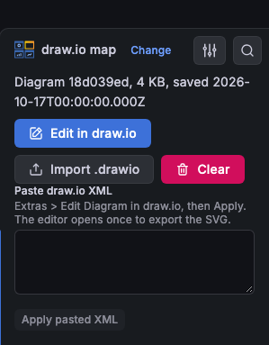

# Editor

The plugin includes the draw.io editor (`dist/drawio`). Edit mode opens it in an iframe inside a modal, in embed mode. The iframe has an opaque origin, so the editor cannot reach the Grafana page (see [security](../security.md) and [ADR 0001](../adr/0001-bundled-editor-opaque-origin.md)). The plugin has no option for another editor URL. An `editorUrl` value that an older version saved is ignored. No draw.io code loads in view mode.

Before the modal makes the editor frame, the panel reads `drawio/js/main.js` of the plugin. If Grafana does not send that file as JavaScript (for example a 404 for a build without `dist/drawio`), the modal shows "The draw.io editor is not installed with this plugin build (dist/drawio is missing)." and a Close button. To repair the build, run `npm run build`: it puts draw.io in `dist/drawio`. If the editor does not open its channel to the panel in 15 s, the modal shows an error and stops to wait. The modal does not try again: close it and open the editor again. A dashboard refresh does not change an open editor.

