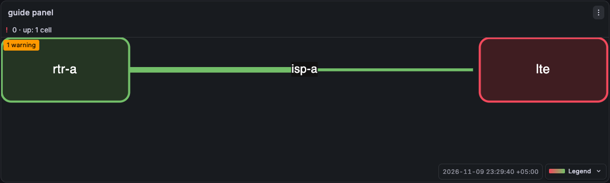
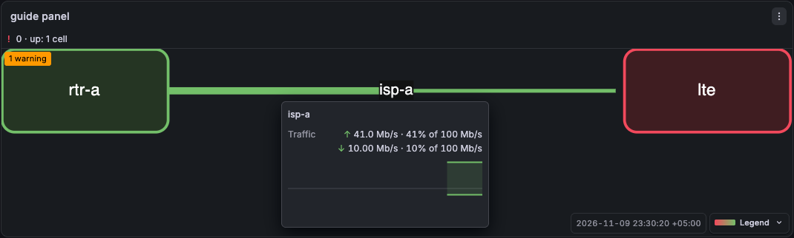

# First diagram

This guide makes a small diagram by hand. It has two nodes and one link. Two queries colour the link. A third query colours the two nodes. The result looks like the panel **hand-drawn** of the demo dashboard.



## Before you start

- Install the plugin. See [Install](install.md).
- Use a data source of the Prometheus type. The queries below read the synthetic series of the development stack of this repository. With a different data source, replace the metric names and the `job` and `device` values with your own.
- In the development stack of this repository, run `npm run build` and `npm run stack:up`. Then open http://localhost:3013. Anonymous access is on, with the Admin role. A generator writes the series that the queries use.

## 1. Add the panel

1. Create a dashboard and add a panel. In Grafana 13, select **Add** > **Panel**, then **Configure visualization**.
2. Select **All visualizations**. Search for `draw.io map` and select it.
3. In the **Queries** tab, select your data source.

## 2. Draw the diagram

1. In the panel options, go to **Diagram** and select **New diagram**. The bundled draw.io editor opens in a dialog. See [Editor](editor.md).
2. Drag the rounded rectangle from the **Shapes** pane to the canvas two times. Type `rtr-a` as the label of the first node and `lte` as the label of the second.
3. Move the pointer over the first node. Drag a blue arrow to the second node. The link goes from `rtr-a` to `lte`.
4. Select the link, press F2 and type `isp-a`. The label is the title of the hover card.
5. Give the link a capacity. Select the link and press Ctrl+M. This opens **Edit Data**. Type `cap`, select **Add Property**, type `100M` and select **Apply**.
6. Select **Diagram** > **Save & Exit**.

The attribute `cap` is the capacity of the link: 100 Mbit/s. See [Capacity](links.md#capacity). The inspector of step 4 cannot write `cap`. Draw.io gives each cell an `id`. You do not need to set it. The label is the text of the cell. See [Cell attributes](bindings.md#cell-attributes).

Select the cell before you press Ctrl+M. When nothing is selected, **Edit Data** changes the page and not a cell.

## 3. Add the queries

Add three queries. Use the **Code** mode of each query. To rename a query, select its letter, type the new name and press Enter. The panel finds a query by this name, the refId.

| refId | Query                                                                               |
| ----- | ----------------------------------------------------------------------------------- |
| `up`  | `up{job=~"node-rtr-a\|node-lte"}`                                                   |
| `tx`  | `rate(node_network_transmit_bytes_total{job="node-isp-a", device="pppoe"}[1m]) * 8` |
| `rx`  | `rate(node_network_receive_bytes_total{job="node-isp-a", device="pppoe"}[1m]) * 8`  |

In the stack, `node-rtr-a` is up, `node-lte` is down, and the link carries about 41 Mbit/s in `tx` and 10 Mbit/s in `rx`. The panel unit is **bits/sec(SI)** by default, so `tx` and `rx` need no unit.

## 4. Bind the cells to the queries

In the panel options, go to **Bindings** and select **Edit bindings**. The dialog has the YAML on the left and the diagram on the right.

1. Select **Insert a starter config** above the code box (it shows while the config is empty), or paste this YAML in the code box. The starter reads the diagram and the targets of the panel and gives a similar config.

   ```yaml
   version: 4
   classes:
     node:
       match:
         key: job
       status: up
     link:
       match:
         key: job
       up: tx
       down: rx
       rows:
         - kind: updown
           label: Traffic
           up: tx
           down: rx
   ```

   - `match` joins the attribute `key` of a cell to the series label `job`.
   - `status: up` colours a node from the query `up`.
   - `up` and `down` are the queries of the two halves of a link. The half at the start of the link takes `up`. See [Links](bindings.md#links).
   - `rows` adds the row **Traffic** to the card of the link. The card of a node shows its status. See [Hover card](hover-card.md).

2. Select a cell in the diagram. The inspector opens below the diagram. Type the `bind` and the `key` of the table, then select **Set bind and key**. Do this for the three cells.

   | Cell  | `bind` | `key`        |
   | ----- | ------ | ------------ |
   | rtr-a | `node` | `node-rtr-a` |
   | lte   | `node` | `node-lte`   |
   | isp-a | `link` | `node-isp-a` |

3. Select **Apply**. Close the dialog.

`bind` is the name of the class of the cell. `key` is the value of the series label `job` that belongs to the cell. You can also add the two attributes in draw.io: select the cell, press Ctrl+M and add `bind` and `key` in **Edit Data**.

The report in the dialog has one tab for each class. The tab **node** shows 2 cells. The tab **link** shows 1 cell. See [The match report](bindings.md#the-match-report).

## 5. Set the node colours

The link already has colours. With `cap`, the thresholds of the panel read the load as a percent of the capacity: green, yellow from 60, red from 85. A node needs other colours, because the value of `up` is 0 or 1.

1. At the end of the options, select **Add field override** and **Fields returned by query**. Select the query `up`.
2. Select **Add override property** and **Thresholds**. Delete the step 60. Change the step 85 to `1` and set its colour to green. Set the colour of **Base** to red.
3. Select **Add override property** and **Standard options > Unit**. Select **Misc** > **Number**. Without this, the status band shows `0 b/s`.

See [How colours and thresholds work](colours.md#how-colours-and-thresholds-work).

## 6. Check and save

1. In the refresh picker, select `10s`. A cell turns stale when its data is older than three query intervals. The card then says "Sample is stale".
2. Look at the panel. The node `rtr-a` is green. The node `lte` is red. The status band says `0 · up: 1 cell`. The link is green. The half from `rtr-a` is thicker, because it carries more load.
3. Move the pointer over the link. The card shows the label `isp-a`, the row **Traffic** and the two loads as a percent of 100 Mb/s.

   

4. The badge **1 warning** says that a label is HTML text. You can ignore it. To remove it, clear **Formatted Text** on the labels in draw.io.
5. Select **Save**. Enter a title. Select **Update default refresh value** and save.

## Next steps

- [Bindings](bindings.md): match, templates, rows, the match report.
- [Colours, status and legend](colours.md): colour schemes, status band, legend.
- [Links](links.md): capacity from a series, arrow styles, value labels.
- [Hover card](hover-card.md): which cells open a card.
- `handDrawnConfigV4` in `src/fixtures/demo-config.ts`: the config of the demo panel.
