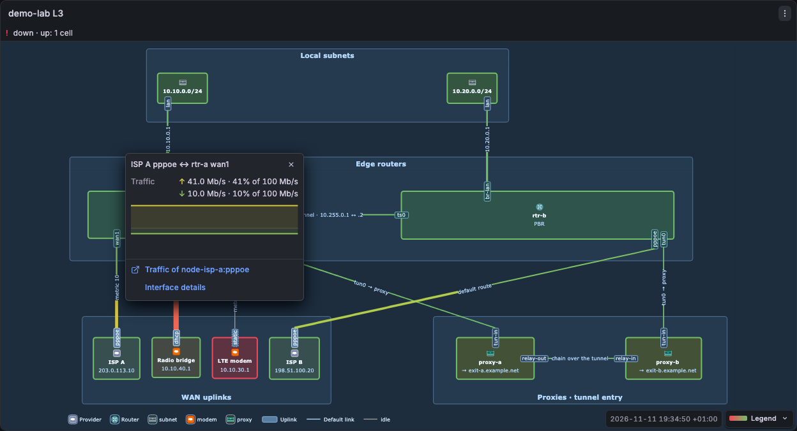
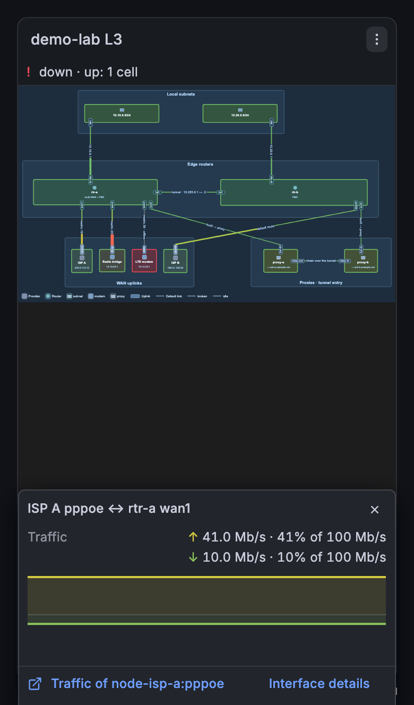

# Hover card

The canvas shows only colours. The values show in a card:

| Action                             | Result                                                                                                                 |
| ---------------------------------- | ---------------------------------------------------------------------------------------------------------------------- |
| Move the mouse on a link or a node | The card shows near the pointer. It goes away when the pointer leaves the cell.                                        |
| Click a cell                       | The card stays (it is pinned). It has a close button (✕), clickable rows and the footer links.                         |
| Click another cell                 | The pinned card moves to that cell.                                                                                    |
| Esc, ✕, or a click outside         | The pinned card closes.                                                                                                |
| Tap a cell (phone, tablet)         | The card opens pinned. Devices without hover (`(hover: none)`) do not open a card on a pointer move.                   |
| Tab to a cell, then Enter or Space | A ring shows around the cell. The card opens pinned below the cell. Esc closes it and the focus goes back to the cell. |
| Move over a chart in a pinned card | A crosshair and the Grafana tooltip show the time and the value of each series (see below).                            |



**Chart tooltip.** In a pinned card, move the pointer over a chart. The standard Grafana tooltip opens.

- Crosshair: it follows the pointer. The tooltip shows the time of the nearest sample.
- Values: the tooltip shows the colour, name and value of each series. The values use the unit and decimals of the field. A gap shows "–". An `updown` row shows both directions in one tooltip.
- N lines: a row with N lines lists the lines (at most 8), then "+N more". A line with no value shows "No data".
- Phone: tap or drag on a chart in the sheet. The tooltip stays until you tap outside the chart.
- Keyboard: Tab to the chart in a pinned card, then use the left and right arrow keys to move the sample. Esc hides the tooltip. A second Esc closes the card.

The tooltip does not change the Y range. The hover card that is not pinned shows no tooltip.

The card stays inside the panel. It scrolls when it is too long. In a panel narrower than 480 px (a phone), the card is a sheet at the bottom of the screen, with the width of the panel. The sheet stays visible also in a panel that is taller than the screen. It is at most 60% of the screen height, scrolls when it is too long, and keeps clear of the home indicator (the safe-area inset). The sheet is above the Grafana menus. ✕, Esc or a tap outside the panel and the sheet closes it. The page does not move when the sheet opens.



## Which cells open a card

A cell opens a card only when both conditions are true:

- The kind of the cell is in the **Hover kinds** panel option (group **View**, option path `hover.kinds`). The default is `node`, `link`, `port` and `other`.
- The card has content: at least one row (a status, a value, a history or a metadata row) or one footer link (the `url` of the class, a `drilldown` row, or a data link of the field config).

Thus by default the empty background (`pg-canvas`), the layers, groups (`pg-group~…`, `pg-groupTitle~…`), the legend (`pg-legend…`) and cells without bound rows or links open nothing.

Only the cells that open a card show the hand cursor and are in the Tab order. Their parts (the icon, the description and the link label) also show the hand cursor, because they open the card of their node or link. All other cells show the default cursor.

| Kind         | Cells                                                                                                  |
| ------------ | ------------------------------------------------------------------------------------------------------ |
| `node`       | `pg-kind="node"`. In a plain draw.io diagram (no `pg-schema`): each vertex.                            |
| `link`       | `pg-kind="link"`. In a plain draw.io diagram: each edge.                                               |
| `port`       | `pg-kind="port"`.                                                                                      |
| `link-label` | `pg-kind="link-label"`.                                                                                |
| `group`      | `pg-group~…` and `pg-groupTitle~…`.                                                                    |
| `canvas`     | `pg-canvas`, `pg-layer~…`, and the draw.io root and layers (cells that draw nothing of their own).     |
| `legend`     | `pg-legend…`.                                                                                          |
| `other`      | Other `pg-` cells and cells with another `pg-kind`, for example a chart anchor with `pg-kind="other"`. |

In the panel JSON, the option is:

```json
"options": { "hover": { "kinds": ["node", "link", "port", "other"] } }
```

To remove the card of one cell, give it a class (or an override) with no `rows`, no `url` and no `status`.

**Card title.** The card, the keyboard label of the cell and the lists in the editor use one readable title for each cell. In a portograph export (a diagram with `pg-schema`):

| Cell | Title                                                                                                              | Example              |
| ---- | ------------------------------------------------------------------------------------------------------------------ | -------------------- |
| Node | The label.                                                                                                         | `Switch-A`           |
| Port | The label of the node and the label of the port.                                                                   | `Switch-A p9`        |
| Link | The two end titles, joined with ↔. The panel adds the link label in parentheses only when both ends read the same. | `Switch-A p9 ↔ AP-1` |

A part or a structure cell of a portograph export uses the caption that the diagram shows:

| Cell                                       | Title, first match wins                                                                                 |
| ------------------------------------------ | ------------------------------------------------------------------------------------------------------- |
| Icon, icon tile, node description          | The title of their node (`pg-of`, else the id after `pg-icon~`, `pg-iconTile~`, `pg-nodeDescription~`). |
| Group (`pg-group~X`)                       | Its own label, else the label of `pg-groupTitle~X`, else the readable id.                               |
| Group title (`pg-groupTitle~X`)            | Its label, else the label of `pg-group~X`, else the readable id.                                        |
| Legend body, tile, swatch (`pg-legend…~X`) | The label of `pg-legendRow~X`, else the readable id. A legend row uses its own label.                   |
| Layer, legend frame                        | Its label (layers draw none), else the readable id.                                                     |

A missing label falls back to the node id and the port name (`pg-node`, `pg-port`), then to the `pg-id` as written, or the cell id without its `pg-…~` prefix when the cell has no `pg-id`. A cell that is not in a portograph export (no `pg-schema`) has its label, else its id. The title is not configurable. A cell attribute named `title` does not change it.

A card row has a head line and a sparkline below it. The head line has a colour dot, the title and the current value with its unit (for example `isp-a → rtr-a   41 Mb/s · 41%`). The title of a row is its `label`, else the display name of the field, else the refId. The sparkline has the full width of the card. Its Y range starts at 0 for a series without negative values (see [Sparkline Y range](bindings.md#sparkline-y-range)). Its time axis is the part of the dashboard time range that has data, so the line goes from edge to edge also when the series starts late. Below the sparkline, muted text shows the min and the max of the series.

The first row of a cell whose status is not `normal` is the state and its reason, for example `warning   probe delay ≥ 400 ms`. The state word has a text-safe colour of its status (red for down and critical, orange for warning and stale, grey for missing). A `normal` status adds no row to a card that has other rows. Then come the rows of the class in their order. The footer has the `url` of the class (title: `urlTitle`), then the data links of the field config of the series of the cell (title: the data link title), then the `drilldown` rows. A data link takes the last value in the frame of its series as its context (`${__value.text}`). A link with the same `href` as an earlier link shows once. A link that opens in a new tab has an external-link icon.

The pinned card is a dialog (`role="dialog"`) and gets the focus. The ✕ button is a normal button. Each bound cell is a button for the keyboard (`tabindex="0"`). The panel builds the card only when it opens, and only for one cell.
