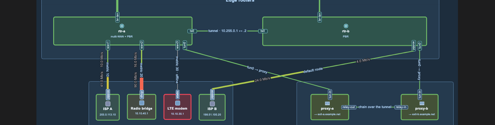

# Links: capacity, arrows and labels

## Capacity

A link has a capacity for each geometric direction, a→b and b→a. For each direction the panel uses the first source that gives a value:

| Order | Source                | Example                   | Notes                                                                                                                                                  |
| ----- | --------------------- | ------------------------- | ------------------------------------------------------------------------------------------------------------------------------------------------------ |
| 1     | A series (`capacity`) | `capacity: speed`         | A refId, or `{ a2b: speed_a, b2a: speed_b }`. The class `match` selects the series. The unit of the field converts the value to bit/s (`Bps` times 8). |
| 2     | The attribute `cap`   | `cap=1G` or `cap=50M/10M` | `1G` is 10⁹ bit/s for both directions. `50M/10M` is 50 Mbit/s a→b and 10 Mbit/s b→a.                                                                   |
| 3     | None                  |                           | The half shows the raw rate and no percent.                                                                                                            |

The panel uses a `capacity` series only when its query is ready and exactly one series gives a finite value above 0 in a rate unit. Else it falls through to `cap` and the report has `capacity-fallback` with the reason: no series, many series, not positive, not finite, not a rate, query failed. A `cap` that does not parse gives `bad-cap` and no capacity for that cell. One value is a number with an optional `k`, `K`, `M`, `G` or `T` (SI, decimal): `^\d+(\.\d+)?[kKMGT]?$`.

The capacities follow the geometry. `at=target` changes only which counter feeds which direction, not the capacities. Example: `cap=50M/10M`, `at=target`, rx 8 Mbit/s: a→b shows 8 Mbit/s and 16 %. The field **Max** is not a capacity.

The hover card shows the capacity of each half in the unit of the value field, for example `41 Mb/s · 41% of 100 Mb/s`; a field in `Bps` with a capacity of 1 Gb/s shows `… of 125 MB/s`. The percent is a whole number: a load above 0 and under 0.5 % reads `<1%` (never `0%`), a real 0 reads `0%`, a load above 999 % reads `>999%`. The percent and the colour do not depend on the unit. Without a capacity, the card shows only the value. A direction without a value is grey "no data", also with a capacity: a capacity never produces a value or a percent on its own.

The units are the data-rate units of Grafana: `bps`, `Kbits` … `Pbits`, `Bps`, `KBs` … `PBs`, and the binary (IEC) forms. A field without a unit is in bit/s. A `capacity` series in a unit that is not a data rate falls through (`capacity-fallback`, "not a rate").

A direction with no series is its own grey half, "no data"; the other half keeps its colour.

The demo dashboard uses both sources: the LAN links take the port speed series `speed`, and the WAN and tunnel links carry `cap=100M`.

## Arrow styles

The `arrow` field selects the head of both link halves. The default is `point`, including saved configs that omit `arrow`.

| Style      | Head                                                                                 |
| ---------- | ------------------------------------------------------------------------------------ |
| `point`    | A tip with a base equal to the drawn stroke width. It has no wings.                  |
| `triangle` | The head with wings used before 1.4.0. Its base is wider than the stroke.            |
| `none`     | No head. The stroke has a flat end at the split or port. It shows no direction mark. |

The `point` and `triangle` heads have the same length. Their length is 8 units up to a 2-unit stroke. Each extra unit of stroke width adds 0.5 units of length.
The `triangle` base is 8 units up to a 2-unit stroke. Each extra unit of stroke width adds 2 units to its base.
On a one-way link, a point tapers along the final path to the port, including a bend.
The stroke stops at the taper base. A triangle keeps the earlier tip position near a bend.
A path that folds back through the taper can require a narrower base. A retraced path can require a shorter taper.
The point tip stays at the port.

```yaml
classes:
  link:
    match: { key: name }
    arrow: triangle
  access:
    extends: link
    arrow: point
overrides:
  edge-demo:
    arrow: none
```

A subclass inherits `arrow` unless it sets its own style. A cell override replaces the inherited style for that cell.
The field applies to links only. There is no panel option.

## Link value labels

Each link half can show its load as a small text beside the stroke, in the middle of its own half, turned to follow the edge. The text is the one the hover card shows for that direction. The labels are off by default; the class field `linkLabel` turns them on:

```yaml
classes:
  lan:
    linkLabel: percent
```

| Mode      | Half with a capacity               | Half without a capacity | No data  |
| --------- | ---------------------------------- | ----------------------- | -------- |
| `percent` | the percent of its capacity, `41%` | the value, `3.1 Mb/s`   | no label |
| `value`   | the value in the unit of its field | the value               | no label |
| `none`    | no label (the default when absent) | no label                | no label |

`linkLabel` is one field: a subclass or an override replaces the mode, and an override with `linkLabel: none` switches one link off. A generator sets `percent` on its link classes. There is no panel option.

Placement rules:

- The label stands first on its own stroke, in the middle of its half. The panel cuts a gap into the dash pattern of the half (`stroke-dasharray`), as long as the text plus 1.5 units on each end. The gap shows what lies behind the stroke, so it needs no colour and is the same in every theme. The panel draws no box. An arrow head is never under a label, so it is never cut.
- When the stroke is not free on the whole half, the label stands beside it. The near edge of its box is 2 units beyond the stroke edge at its widest (`linkWidth.max`). A chip or a pill that is wider than the stroke can need 4 units. The label then takes 4.
- A label has a thin halo (1 unit outside the glyphs, behind them) in the background colour of the diagram. That colour is the computed `background-color` of the svg root, resolved for the colour scheme of the panel. When the diagram has no background, it is the canvas colour of the Grafana theme. The stroke of its own half is cut under the label. The frame line of a group is not an obstacle: the halo keeps the text readable over it.
- The top side is the side that the tops of the letters face: above a horizontal edge, to the left of a vertical one (the text reads bottom to top). On a diagonal edge it is the side of the text top. The text is never upside down.
- The two halves stand in one place near the link when one place holds both. The order is: both on their strokes, both on the top side, both on the bottom side, with the 2-unit gap. When no such place holds both, each half takes its own nearest place. A half that is free on its stroke stays there, also when the other half must stand farther out.
- A label moves along its half, away from the arrow heads first, when one of these is in its way: a node, a plain text cell, the text of an edge (its own value text or an edge label cell, also of the edge that the label belongs to), a port pill, a portograph label chip, an end dot, an arrow head, another edge (or a crossing run of its own edge), or another label. Only the stroke of its own half is never in the way. An arrow head counts at the size it has at `linkWidth.max`, so a wider half on a refresh never grows its head under a label.
- A half that fits nowhere can stand beside a bend, with its centre on a straight run and its box over the end of the run. This applies only when the label is clearly nearer to its own stroke than to any other link.
- On a link so short that every spot beside the stroke meets an arrow head at its widest, the label stands 4 units beyond the wings of the arrow head of its half as drawn. It moves out with the head when the load grows. When something else is in the way there, the label stands 4 units beyond the wings of the widest head. The panel drops the label when its half is too short or every spot is taken.
- Backgrounds are not in the way: the portograph canvas and groups (but the title text of a group or container is), and, in a plain draw.io diagram, a vertex whose body holds two or more other vertices (a container or a swimlane). A device with one badge inside stays in the way.
- The placement runs once for each diagram. A data refresh changes the text only. A percent label keeps one slot from `<1%` to `>999%`. A value label can move when its text grows past a 4-unit step, and only that label moves.

On a phone or a small panel the labels hide when a glyph would be smaller than 7 CSS px (a 1900 px sheet fitted into a 390 px screen), and show again after a pinch. A **Minimum scale** of 1.3 or more shows them at load. A tap on a label opens the card of its link.


