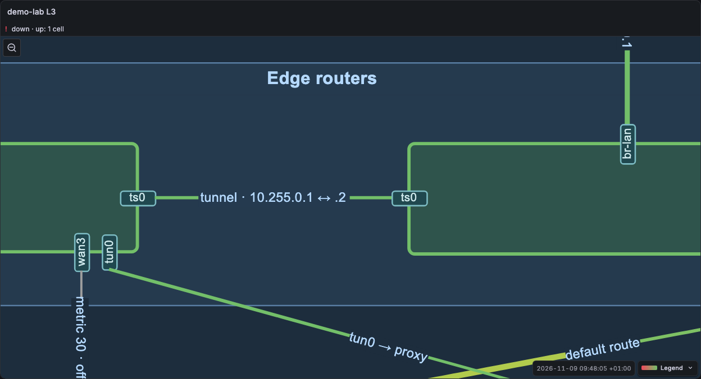

# Zoom

The options are in the **View** group of the panel options. **Zoom** and **Align** are rows of icon buttons, so that they fit in a narrow options pane. Move the pointer on an icon, or focus it, to see its name and meaning.

| Option               | Meaning                                                                                                                                                                         |
| -------------------- | ------------------------------------------------------------------------------------------------------------------------------------------------------------------------------- |
| Zoom: Fit            | The whole diagram fits in the panel. This is the default.                                                                                                                       |
| Zoom: Fit width      | The diagram has the panel width. The panel scrolls vertically.                                                                                                                  |
| Zoom: Original       | The diagram has its original size.                                                                                                                                              |
| Zoom: Custom, Zoom % | The diagram has the size that you set in percent.                                                                                                                               |
| Minimum scale        | Fit and Fit width only. Do not shrink below this scale in Fit modes; the panel scrolls instead. 1 = 100%. Default 0: off. See [Minimum scale](#minimum-scale).                  |
| Align                | Fit only. **Top** (default): when the panel is taller than the diagram, the diagram is at the top. **Center**: it is in the middle. The diagram is always centred horizontally. |
| Wheel zoom           | The mouse wheel zooms the view. Off by default.                                                                                                                                 |
| Drag pan             | A mouse drag moves the view. Off by default.                                                                                                                                    |
| Link width min, max  | The range of the link width in pixels. The width grows with the load. The head size follows the width and the class field `arrow`. See [Arrow styles](links.md#arrow-styles).   |
| Hover kinds          | The cell kinds that open a card (see [Which cells open a card](hover-card.md#which-cells-open-a-card)). Default: node, link, port, other.                                       |
| Status summary rows  | The maximum number of rows in the status band above the diagram (see [Status summary](colours.md#status-band)). Default 3. 0 hides the band.                                    |

## Live zoom

You can zoom and pan the view of the panel. The live zoom does not change the saved panel options.

| Gesture                            | Result                                                                                                                            |
| ---------------------------------- | --------------------------------------------------------------------------------------------------------------------------------- |
| Pinch with two fingers             | Zooms around the point between the fingers. A move of the two fingers pans.                                                       |
| One finger, at the configured zoom | Scrolls the page, or the panel when it scrolls. A tap opens the card.                                                             |
| One finger, when zoomed            | Pans the view. A tap (less than 6 px of movement) opens the card. On a chart region, it reads the chart values and does not pan.  |
| Trackpad pinch (Ctrl+wheel)        | Zooms around the pointer. This is always on.                                                                                      |
| Mouse wheel                        | Zooms only when **Wheel zoom** is on. Else it scrolls the panel or the page.                                                      |
| Mouse drag                         | Pans when the view is zoomed, or at all times when **Drag pan** is on. This also applies to a drag that starts on a chart region. |

The scale stays between 0.2× and 10× of the configured zoom. When the view is not at the configured zoom, a **Reset zoom** button shows in the top-left corner of the panel, below the status band and above the legend. The top-right corner stays free for the Grafana panel menu button. The warning badge is next to the button. Click or tap it to go back to the configured zoom; a panel that scrolls goes back to its top-left corner. A new panel size or a new **Zoom** option also resets the view.

The panel sets `touch-action: pan-x pan-y` at the configured zoom: one finger scrolls the page, and the browser does not pinch-zoom the page over the panel. When the view is zoomed, the panel sets `touch-action: none` and takes all touches. A two-finger `touchmove` calls `preventDefault()`, so the page does not scroll while you pinch.



## Minimum scale

A large sheet in a narrow panel can make the labels too small to read. For example, a 1900 px sheet in an 860 px panel shows 11 px labels at 5 px. Set **Minimum scale** to keep the labels readable:

```json
{ "zoom": { "mode": "fit-width", "minScale": 1.3 } }
```

- The panel calculates the Fit or Fit width scale as usual. When that scale is less than **Minimum scale**, the panel uses **Minimum scale**.
- When the diagram is then larger than the panel, the panel scrolls horizontally, vertically or in the two directions. The diagram starts at the top-left corner. When the diagram is narrower than the panel, it stays centred horizontally.
- Fit width with a minimum scale: the diagram height is the sheet height × the scale.
- The status band stays above the area that scrolls. Cards open at the pointer also after a scroll.
- At the configured zoom, the mouse wheel and one finger scroll the panel. At the end of the panel, the page scrolls. The live zoom works as before: the **Reset zoom** button goes back to the minimum scale view.
- 0 (the default) turns the option off.
